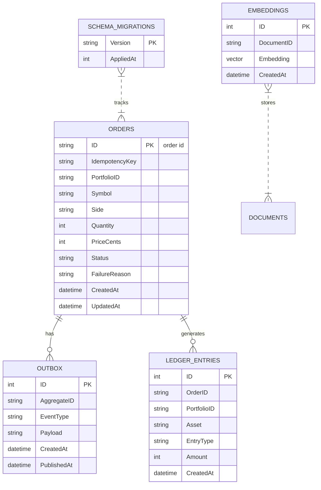

# Fin-AI Advisor

A **reference architecture** for an AI-assisted investment platform: a high-concurrency transactional core in **Golang** (Command + worker pool, saga compensation, transactional outbox, idempotency), an AI service in **Python 3.11+** (LangGraph workflow, RAG with verifiable citations, guardrails, human-in-the-loop, offline evals), infrastructure as code on AWS with **Terraform**, and a **GitHub Actions** CI pipeline with quality, security and AI-evaluation gates.

> Scope: this is a demonstrative system with synthetic data. Each diagram in [docs/architecture-design.md](docs/architecture-design.md) states what is implemented, simulated, or planned.

## 🛠️ Tecnologías

- **Golang 1.22+** – High-concurrency transactional backend.
- **Python 3.11+** – AI/MLOps service with LangChain, LangGraph.
- **Terraform** – IaC for AWS infrastructure.
- **AWS** – VPC, RDS PostgreSQL 16 (pgvector), ECR, ECS Fargate.
- **PostgreSQL 16** – Relational DB with vector extension.
- **GitHub Actions** – CI/CD, DevSecOps pipeline.
- **Ruff** – Python linter & formatter.
- **Pytest** – Python testing framework.
- **Go tooling** – go test, race detector, concurrency utilities.
- **LangChain & LangGraph** – RAG and workflow orchestration.
- **OpenAI & Alpaca models** – Finetuning and inference.

---

## 🏛️ Monorepo Architecture

```text
/AI-Advisor
├── docs/
│   ├── architecture-design.md             # Architecture diagrams (Mermaid) + implementation status
│   ├── adr/                               # Architecture Decision Records (ADRs)
│   │   ├── 001-command-worker-pool-go.md  # ADR 001: Command Pattern & Worker Pool in Go
│   │   ├── 002-strategy-pattern-ai-python.md # ADR 002: Strategy Pattern & RAG in Python
│   │   ├── 003-persistence-outbox-sqlite.md # ADR 003: Outbox, Append-only Ledger & SQLite
│   │   └── 004-ai-advisory-guardrails-hitl-evals.md # ADR 004: LangGraph, Guardrails, HITL & Evals
│   ├── README.md                          # Start here: guided tour, decisions & trade-offs, demo
│   ├── patterns-and-references.md         # Book patterns behind each component + OWASP LLM Top 10
│   └── diagrams/README.md                 # All diagrams in one place (components, infra, DB, vector DB, LangGraph, guardrails)
├── portfolio-api/                         # Transactional Backend (Go 1.27)
│   ├── cmd/api/main.go                    # REST HTTP Server, Telemetry & Graceful Shutdown
│   ├── internal/domain/trade_command.go   # Command Pattern & Saga Compensation (Execute / Undo)
│   ├── internal/domain/trade_command_test.go # Domain Unit & Saga Compensation Tests
│   ├── internal/engine/worker_pool.go     # Concurrent Worker Pool with Backpressure & DB Semaphore
│   ├── internal/engine/worker_pool_test.go # High Concurrency, Drain & Backpressure Tests
│   ├── internal/store/                    # SQLite persistence: migrations, outbox, ledger, idempotency
│   ├── internal/orders/                   # Use case service, persistence Decorator, outbox Relay
│   ├── internal/httpapi/                  # REST handlers, DTOs and error mapping
│   └── go.mod
├── ai-service/                            # AI/MLOps Service (Python 3.11+)
│   ├── src/graph.py                       # LangGraph workflow: retrieve → assess → propose → guardrails → HITL/execute
│   ├── src/strategy.py                    # Strategy Pattern + deterministic quant core (volatility, VaR)
│   ├── src/llm.py                         # LLMClient protocol: Claude structured outputs / deterministic fake
│   ├── src/retrieval.py                   # RAG: citable chunks, TF-IDF retriever, multi-query + RRF
│   ├── src/guardrails.py                  # Groundedness, suitability, funding and human-review rules
│   ├── src/resilience.py                  # Circuit breaker + graceful degradation (Decorator)
│   ├── src/rebalancing.py                 # Target allocation → BUY orders matching the Go API contract
│   ├── src/api.py                         # FastAPI service (advice, review, health)
│   ├── src/knowledge/                     # Knowledge base (synthetic policy & market documents)
│   ├── evals/                             # Golden set + offline eval harness (CI quality gate)
│   ├── scripts/generate_finetuning_dataset.py # Teacher-labeled (distilled) fine-tuning dataset
│   ├── tests/                             # Pytest suite (quant core, RAG, guardrails, graph, API)
│   ├── pyproject.toml                     # Python Package, Ruff Linter & Pytest Config
│   └── README.md                          # AI Service Documentation
├── infra/                                 # Infrastructure as Code (Terraform AWS)
│   ├── main.tf                            # Root module: composes the AWS environment from modules/
│   ├── modules/                           # network · security · database · registry · edge · compute · app-secrets · state-backend
│   ├── tests/                             # terraform test suites (mocked AWS provider, 23 tests)
│   ├── localstack/                        # Same modules applied to LocalStack + boto3 smoke tests
│   └── .tflint.hcl                        # TFLint + AWS ruleset
├── .github/
│   ├── workflows/ci-mlops.yml             # 3-stage CI: quality, security, containers, infra integration
│   └── actions/setup-pinned-tool/         # Composite action: pinned + SHA-256 verified tool installs
├── .gitignore
└── README.md                              # Root Monorepo Documentation
```

> 🧭 **Start here:** [docs/README.md](docs/README.md) is a 30-minute guided tour with the end-to-end flow, a table of key decisions and trade-offs, the CI pipeline and a demo script.
>
> 📐 **Diagrams:** [all diagrams in one place](docs/diagrams/README.md) · [system architecture](docs/architecture-design.md) · [Go backend internals](portfolio-api/README.md) · [AI workflow, RAG and guardrails](ai-service/README.md) · [evals](ai-service/evals/README.md) · [AWS infrastructure](infra/README.md) · [patterns and book references](docs/patterns-and-references.md)


---

## 🚀 Services & Local Development

### 1. Transactional Backend (`portfolio-api` - Go)

The Go backend handles high-throughput financial orders with strict consistency and non-blocking backpressure:
- **Command Pattern ([Refactoring.Guru: Command](https://refactoring.guru/design-patterns/command)):**
  - Encapsulates trade operations behind the canonical `Command` interface with `Execute(ctx)` and `Undo(ctx)`.
  - Enables distributed **Saga Pattern compensation** (rollback) if execution fails downstream in the brokerage ledger.
- **Worker Pool Engine:**
  - Employs a fixed pool of $N$ worker goroutines consuming from a buffered channel using non-blocking `select`/`default` semantics.
  - Automatically triggers **backpressure** (`HTTP 429 Too Many Requests`) when the queue reaches capacity, protecting system stability.
  - Controls maximum concurrent PostgreSQL transactions via an internal channel semaphore (`dbConnSemaphore`), eliminating **database connection starvation**.
  - Provides thread-safe, atomic operational metrics (`atomic.Uint64`).

```bash
cd portfolio-api

# Run unit tests and concurrency race detection
go test -v -race ./...

# Start the REST API server locally (port 8080)
go run ./cmd/api            # Listens on 127.0.0.1:8080 (set HOST=0.0.0.0 only inside containers)
```

- **Durable persistence ([ADR 003](docs/adr/003-persistence-outbox-sqlite.md)):** SQLite (pure Go, no cgo) with a **transactional outbox** + relay (no lost orders on crash), **Idempotency-Key** support (safe client retries), an **append-only ledger** enforced by triggers, and money stored as **integer cents**.

#### Key HTTP Endpoints:
- `GET /health`: Service + database health check.
- `GET /api/v1/metrics`: Real-time Worker Pool telemetry (submitted, executed, compensated, rejected, duplicate deliveries).
- `POST /api/v1/orders/buy`: Accepts an order asynchronously. `202` new order · `200` idempotent replay · `400` invalid · `429` backlog exceeded (`Retry-After`).
- `GET /api/v1/orders/{id}`: Order status plus its ledger entries.
- `GET /api/v1/portfolios/{id}/positions`: Positions derived from the ledger (`SUM ... GROUP BY`).

```bash
curl -i -X POST localhost:8080/api/v1/orders/buy \
  -H 'Content-Type: application/json' -H 'Idempotency-Key: demo-1' \
  -d '{"portfolio_id":"port-demo","symbol":"NVDA","quantity":5,"price":"120.25"}'
```

---

### 2. AI & MLOps Service (`ai-service` - Python 3.11+)

The AI service turns a portfolio into a reviewed, executable rebalancing plan ([ADR 004](docs/adr/004-ai-advisory-guardrails-hitl-evals.md)):
- **LangGraph workflow (not an autonomous agent):** `retrieve → assess → propose → guardrails`, then routes to `reject`, `human_review` (paused with `interrupt()` and resumed via the review API) or `execute`. Execution calls the Go API with idempotency keys derived from the graph thread.
- **"The LLM explains, the code computes":** volatility, parametric VaR (√t scaling) and concentration come from a deterministic quant core. The LLM returns a **schema-validated** opinion (Pydantic; Claude `claude-opus-5-5` via `messages.parse`) citing knowledge-base chunks.
- **RAG with verifiable citations:** citable chunk ids and multi-query retrieval fused with **Reciprocal Rank Fusion**. Guardrails reject any citation that was not retrieved.
- **Guardrails:** blocking (hallucinated sources, unsuitable assets, invalid or unfunded allocations) vs. human review (high risk, large trades, concentration, degraded mode).
- **Resilience:** a circuit breaker wraps the LLM strategy. While it is open, a rule-based fallback answers and the result is flagged for mandatory review.
- **Offline evals as a CI gate:** a golden set with adversarial cases measures route accuracy, retrieval recall, groundedness, policy compliance and guardrail catch rate.
- **Fine-tuning dataset (MLOps):** teacher-labeled (distilled) samples in OpenAI Chat and Alpaca formats, with a data-quality gate (no duplicates, label variability).

```bash
cd ai-service

uv run ruff check . && uv run ruff format --check .   # Lint & format
uv run pytest -v                                      # Unit + integration tests
uv run python evals/run_evals.py                      # Offline AI evals (fails below thresholds)

# API on loopback only; OpenAPI docs at http://127.0.0.1:8000/docs
uv run uvicorn src.api:app --host 127.0.0.1 --port 8000

# Optional: real LLM (Claude) instead of the deterministic fake
uv sync --extra llm && LLM_PROVIDER=anthropic uv run python evals/run_evals.py

# Teacher-labeled fine-tuning dataset + quality stats
uv run python scripts/generate_finetuning_dataset.py --num-samples 200 --output-dir data/finetuning --format both
```

---

### 3. Cloud Infrastructure (`infra` - Terraform AWS)

The infrastructure is split into **reusable Terraform modules** and tested in four layers, up to a real `apply` against **LocalStack** ([infra/README.md](infra/README.md)):
- **Networking (`network`):** Multi-AZ VPC with Public (ALB/NAT), Private (ECS Fargate) and isolated Database subnets; one NAT per AZ in `prod`; VPC flow logs.
- **Security (`security`):** chained least-privilege security groups (ALB → ECS → RDS); the only internet egress is HTTPS.
- **Edge and compute (`edge`, `compute`):** ALB with path routing (`/api/*`, `/v1/*`), ECS Fargate services with deployment rollback, CPU autoscaling, Cloud Map, and alarms to a KMS-encrypted SNS topic.
- **Data (`database`, `app-secrets`, `state-backend`):** RDS PostgreSQL 16 (encrypted, Multi-AZ and deletion protection in `prod`), secrets in Secrets Manager, and a versioned, KMS-encrypted S3 + DynamoDB state backend.
- **Registry (`registry`):** ECR repositories with immutable tags, scan on push and a lifecycle policy.
- **Testing:** TFLint, 23 `terraform test` cases with a mocked AWS provider, Trivy (0 CRITICAL, 0 HIGH), and a LocalStack apply verified through the AWS API, with a drift check and teardown.



```bash
cd infra
terraform fmt -check -recursive
terraform init -backend=false && terraform validate
tflint --init && tflint --recursive
terraform test                                          # mocked AWS: no account, no cost

docker compose -f localstack/docker-compose.yml up -d --wait
./localstack/run.sh                                     # apply → verify → drift check → destroy
```

---

### 4. CI/CD & DevSecOps Pipeline (`.github/workflows/ci-mlops.yml`)

The GitHub Actions workflow runs in three stages on every pull request and push to `main`, with read-only permissions. Every job can fail the build.

**Stage 1 · fast feedback (parallel)**
1. **`secrets-scan`:** Gitleaks over the full git history, with a narrow allowlist for documented placeholders.
2. **`go-backend-ci`:** module verification, `go vet`, unit, concurrency and SQL integration tests with `-race`, a coverage summary, and **govulncheck** (fails only on vulnerabilities the code actually reaches).
3. **`python-ai-ci`:** Ruff, Pytest, the **offline AI evals** (route accuracy, retrieval recall, groundedness, policy compliance, guardrail catch rate) and **pip-audit** on the locked runtime dependencies.
4. **`terraform-static`:** `fmt`, `validate`, **TFLint** with the AWS ruleset, **`terraform test`** with a mocked provider, and **Trivy** (CRITICAL blocks the build).
5. **`dockerfile-lint`:** Hadolint on both Dockerfiles.

**Stage 2 · integration**
6. **`mlops-dataset-validation`:** generates the teacher-labeled fine-tuning dataset, validates the JSONL and applies a **data quality gate**.
7. **`container-build-scan`** (one job per service): builds the image tagged with the commit SHA, starts it and checks `/health` and the non-root user, scans it with **Trivy** (fixable CRITICAL CVEs block the build) and uploads a **CycloneDX SBOM**.
8. **`infra-localstack`:** applies the Terraform modules to **LocalStack**, verifies every resource through the AWS API, requires an empty second plan (idempotency), then destroys everything.

**Stage 3 · report**
9. **`pipeline-summary`:** writes a gate table to the run summary and fails if any gate failed.

All third-party binaries (Gitleaks, TFLint, Trivy, Hadolint) are pinned and **SHA-256 verified** through one composite action.

Pipeline diagram: [docs/README.md#cicd-pipeline](docs/README.md#cicd-pipeline).
