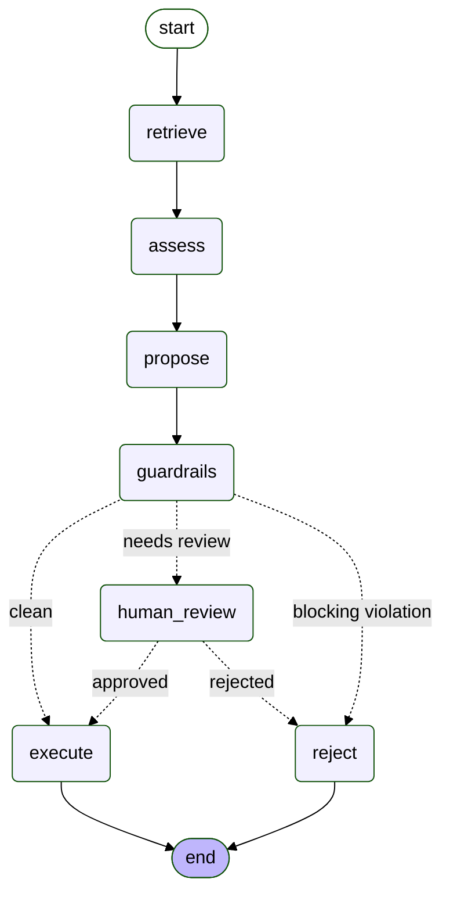
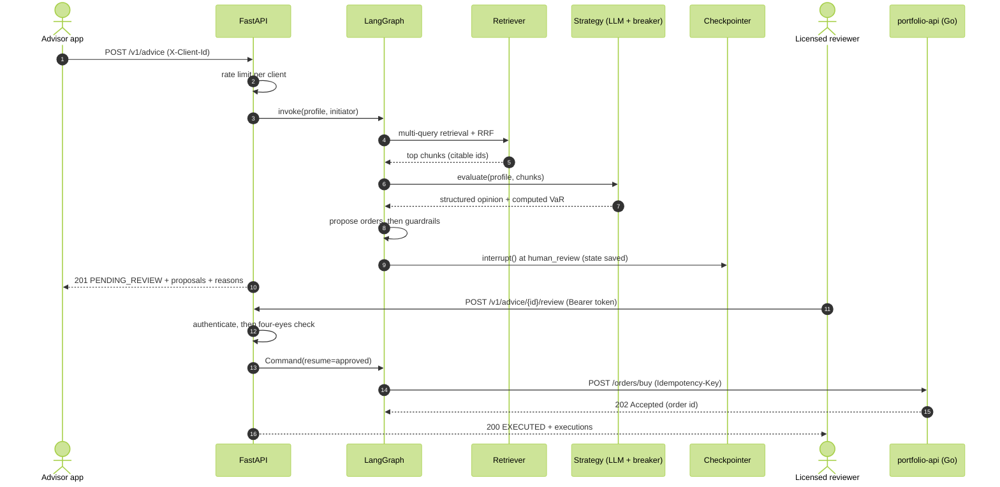
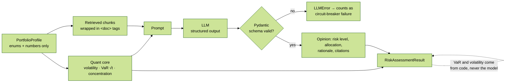
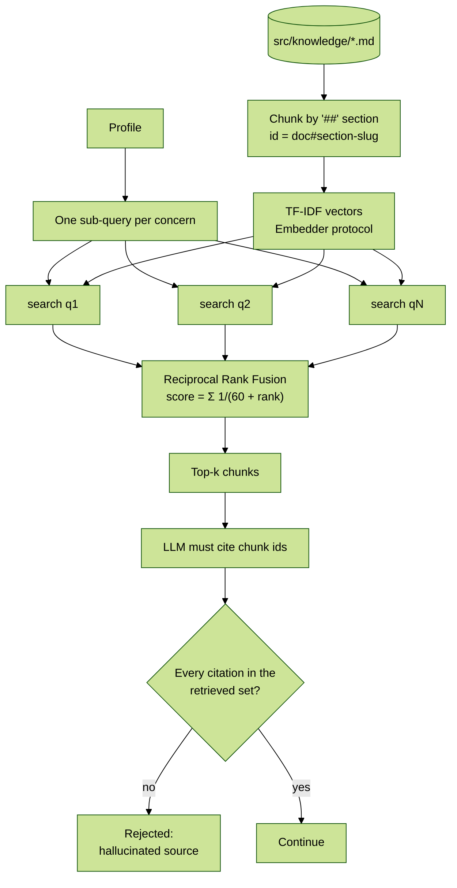
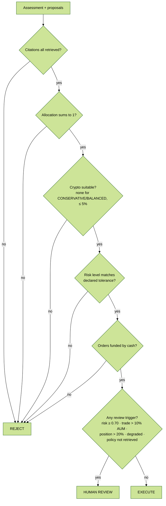
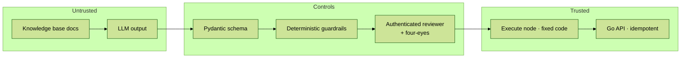

# AI Service (`ai-service`)

Turns a client portfolio into a **reviewed, executable rebalancing plan**. It uses RAG over internal policy documents, an LLM constrained to structured output, deterministic risk math, guardrails, human-in-the-loop approval and idempotent execution against the Go backend.

> Design rationale: [ADR 004](../docs/adr/004-ai-advisory-guardrails-hitl-evals.md) · Patterns and book references: [docs/patterns-and-references.md](../docs/patterns-and-references.md)

---

## 1. The workflow (LangGraph)

This diagram was **generated from the compiled graph** (`graph.get_graph().draw_mermaid()`), so it always matches the code. Dotted arrows are conditional edges.



| Node | What it does | Code |
|---|---|---|
| `retrieve` | Splits the profile into one sub-query per concern (risk band, crypto, concentration, idle cash, bonds). Retrieves the top chunks for each and fuses the rankings with **Reciprocal Rank Fusion**. | `build_retrieval_queries`, `Retriever.search_many` |
| `assess` | Runs the active **Strategy** (LLM RAG behind a circuit breaker, falling back to rule-based). | `strategy.py`, `resilience.py` |
| `propose` | Converts the target allocation into BUY orders funded only by available cash. | `rebalancing.py` |
| `guardrails` | Applies blocking rules and human-review triggers. | `guardrails.py` |
| `human_review` | Pauses the graph with `interrupt()`. The checkpointer persists state until a reviewer responds. | `graph.py` |
| `execute` | Sends orders to `portfolio-api` with `Idempotency-Key = <thread>:<i>:<symbol>`. | `PortfolioApiExecutor` |
| `reject` | Terminal state. Nothing is executed. | `graph.py` |

**Why a workflow and not an autonomous agent?** The steps are known in advance and the cost of a mistake is real money. The LLM decides the *content* of one step, and the code decides the *control flow*. That trades autonomy for reliability and auditability, which is what a regulated domain needs.

---

## 2. Request lifecycle with human approval



---

## 3. "The LLM explains, the code computes"



- The user never sends free text to the model; the prompt is built from validated enums and numbers. That removes **direct** prompt injection as an attack surface.
- Claude is called through `client.messages.parse(output_format=LLMRiskOpinion)`, so the response is **schema-validated**, not parsed from text.
- `PROMPT_VERSION` is a hash of the system prompt. It is recorded on every assessment, so a prompt change is always traceable.

---

## 4. RAG: retrieval with verifiable citations



- **Why multi-query + RRF?** A single query that concatenated every concern diluted the specific terms: the crypto policy document fell to 7th place. The offline evals caught it, and the regression test is `test_multi_query_rrf_avoids_query_dilution`.
- **Why TF-IDF?** It is deterministic, so CI and evals are reproducible, and it handles exact matches well (tickers, policy names). The `Embedder` protocol allows swapping in dense embeddings or hybrid search (pgvector in production) without touching callers. That swap should only happen once the golden set shows a recall gain.

---

## 5. Guardrails: block vs. escalate



Blocking rules protect against **wrong** answers, and review triggers protect against **risky** ones. Not everything goes to a human, only what crosses a threshold, so reviewers scale.

---

## 6. Resilience

`ResilientRiskStrategy` is a **Decorator** that wraps the LLM strategy with a circuit breaker:

| State | Behavior |
|---|---|
| `CLOSED` | Calls the LLM. Failures (HTTP errors, refusals, invalid schema) are counted. |
| `OPEN` | Fails fast without calling the provider. The rule-based strategy answers and the result is flagged `degraded`. |
| `HALF_OPEN` | After 30 s, one probe request. On success the circuit returns to `CLOSED`; on failure it goes back to `OPEN`. |

A degraded answer always requires human review, so **availability never bypasses control**. Diagrams: [docs/architecture-design.md §4](../docs/architecture-design.md#4-resilience-circuit-breaker-and-graceful-degradation).

---

## 7. Security controls (trust boundary)



| Risk (OWASP LLM Top 10) | Control in this service |
|---|---|
| Prompt injection (direct) | There is no free-text user input to the model. |
| Prompt injection (indirect, via documents) | `<doc>` content is declared untrusted, guardrails block unsuitable output, and there is a poisoned-document test plus a golden-set case. |
| Insecure output handling | Schema validation. Orders are built by code, never by the model. |
| Excessive agency | The LLM has no tools. A fixed workflow, HITL with authenticated reviewers and four-eyes, idempotent execution. |
| Overreliance / misinformation | VaR is computed, citations are verified, degraded answers are flagged and high risk is escalated. |
| Unbounded consumption | Per-client rate limit (429 + `Retry-After`), circuit breaker, `max_tokens`. |

---

## 8. Observability

Every run exposes `meta` (`GET /v1/advice/{id}`) and emits one JSON log line without personal data:

```json
{"event": "advice_completed", "thread_id": "adv_…", "status": "PENDING_REVIEW",
 "strategy": "LLM-RAG[fake-llm]", "prompt_version": "3f2a…", "degraded": false,
 "review_reasons": ["BND trade 28,125 USD exceeds 10% of AUM"],
 "retrieved": ["investment_policy#strategic-allocation-bands-by-risk-tolerance", "…"],
 "node_latency_ms": {"retrieve": 1.9, "assess": 0.8, "propose": 0.2, "guardrails": 0.3}}
```

`GET /metrics` reports the health signals worth alerting on: **fallback rate**, **guardrail block rate**, **human review rate** and **human override rate** (how often reviewers reject the AI).

---

## 9. Evaluation

Offline evals run in CI and fail the build below their thresholds. See [evals/README.md](evals/README.md).

---

## 10. Fine-tuning dataset (MLOps)

`scripts/generate_finetuning_dataset.py` produces OpenAI-chat and Alpaca JSONL. Labels come from a **teacher**: the deterministic quant pipeline applied to each synthetic portfolio (distillation). Earlier, labels came from a constant table per archetype, and a model trained on that would only memorize the archetype. `dataset_stats.json` reports duplicates and the label spread per archetype, and CI enforces both.

---

## Run it

```bash
cd ai-service
uv sync

uv run pytest -v                       # unit + integration tests
uv run python evals/run_evals.py       # offline evals (non-zero exit below thresholds)
uv run ruff check . && uv run ruff format --check .

# API on loopback only; docs at http://127.0.0.1:8000/docs
REVIEWER_TOKENS="dev-token-alice=alice" uv run uvicorn src.api:app --host 127.0.0.1 --port 8000

# Real LLM (Claude) instead of the deterministic fake
uv sync --extra llm
LLM_PROVIDER=anthropic uv run python evals/run_evals.py

# Execute approved orders against the Go API running locally
PORTFOLIO_API_URL=http://127.0.0.1:8080 uv run uvicorn src.api:app --host 127.0.0.1 --port 8000
```

### Try the API

```bash
# 1. Request advice (the client id would come from the gateway / JWT in production)
curl -s -X POST http://127.0.0.1:8000/v1/advice -H 'Content-Type: application/json' \
  -H 'X-Client-Id: advisor-app' -d '{
    "user_id": "u1", "portfolio_id": "p1", "total_aum": 187500, "cash_balance": 60000,
    "risk_tolerance": "BALANCED", "investment_horizon_years": 7,
    "holdings": [
      {"symbol": "VOO", "quantity": 200, "current_price": 450, "asset_class": "EQUITY"},
      {"symbol": "BND", "quantity": 500, "current_price": 75, "asset_class": "FIXED_INCOME"}]}'

# 2. Approve it as an authenticated reviewer (identity comes from the token)
curl -s -X POST http://127.0.0.1:8000/v1/advice/<thread_id>/review \
  -H 'Authorization: Bearer dev-token-alice' -H 'Content-Type: application/json' \
  -d '{"approved": true, "comment": "client confirmed"}'

curl -s http://127.0.0.1:8000/metrics
```

## Module map

| File | Responsibility |
|---|---|
| `src/graph.py` | LangGraph workflow, `AdvisoryService` facade, executors, health counters, JSON logs |
| `src/strategy.py` | Strategy pattern, quant core, `LLMRagStrategy`, prompt + version |
| `src/llm.py` | `LLMClient` protocol, `AnthropicLLMClient`, deterministic `FakeLLMClient` and adversarial responders |
| `src/retrieval.py` | Chunking, TF-IDF `Embedder`, `Retriever.search` / `search_many` (RRF) |
| `src/guardrails.py` | Blocking rules and review triggers |
| `src/resilience.py` | Circuit breaker + `ResilientRiskStrategy` decorator |
| `src/rebalancing.py` | Target allocation → BUY orders matching the Go API contract |
| `src/api.py` | FastAPI app, reviewer auth, four-eyes, rate limiting, metrics |
| `src/knowledge/` | Synthetic knowledge base (policy, suitability, market notes) |
| `evals/` | Golden set + offline eval harness |
| `scripts/generate_finetuning_dataset.py` | Teacher-labeled fine-tuning dataset + quality stats |
