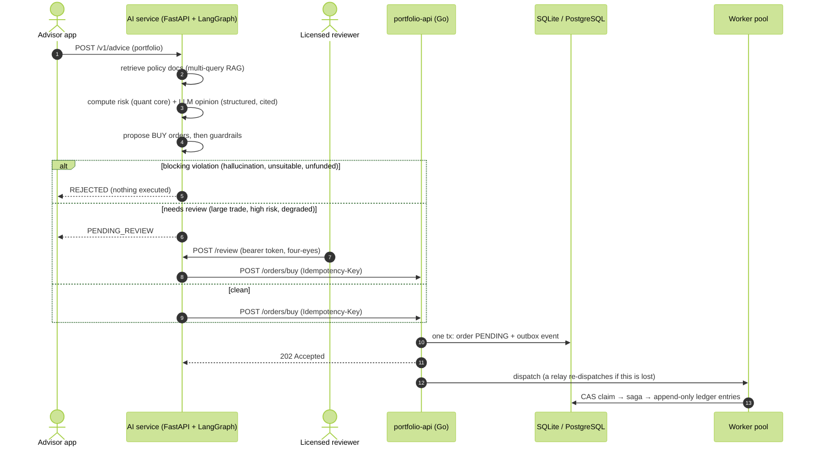
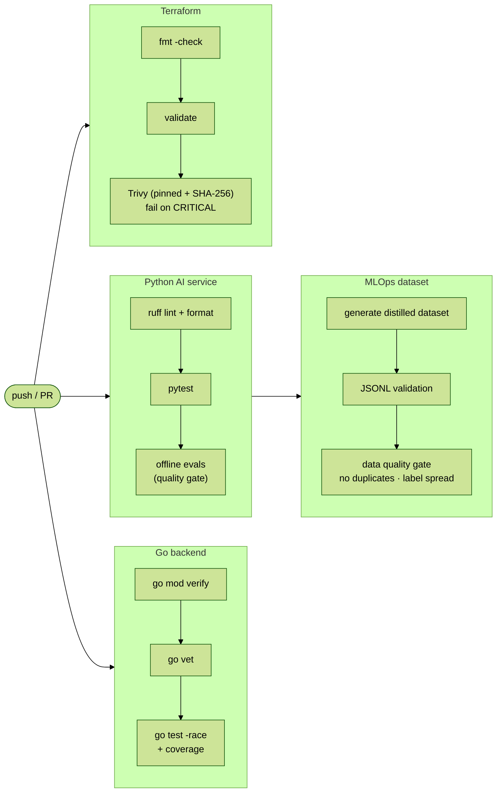

# Documentation Guide

Start here to understand the system in about 30 minutes.

## Suggested reading order

| # | Read | Time | You will understand |
|---|---|---|---|
| 1 | This page: end-to-end flow and decision table | 5 min | The whole system and its main trade-offs |
| 2 | [architecture-design.md](architecture-design.md) | 5 min | Diagrams for each part, with honest implementation status |
| 3 | [../portfolio-api/README.md](../portfolio-api/README.md) | 8 min | Concurrency, outbox, idempotency, saga, SQL schema, failure scenarios |
| 4 | [../ai-service/README.md](../ai-service/README.md) | 8 min | LangGraph workflow, RAG, guardrails, HITL, resilience, security |
| 5 | [../ai-service/evals/README.md](../ai-service/evals/README.md) | 2 min | How AI quality is gated in CI, and the bugs it caught |
| 6 | [adr/](adr/) | as needed | Why each decision was made and what it costs |
| 7 | [patterns-and-references.md](patterns-and-references.md) | as needed | Book chapters behind each pattern; OWASP LLM Top 10 coverage |
| 8 | [../infra/README.md](../infra/README.md) | 2 min | AWS topology, least-privilege security groups, known gaps |

---

## End-to-end flow



---

## Key decisions and trade-offs

| Decision | Alternative considered | Why this one | What it costs |
|---|---|---|---|
| **LangGraph workflow**, LLM in one node | Autonomous agent with tools | Known steps, auditable control flow, no excessive agency | Less flexible; new behaviors need new nodes |
| **The LLM explains, the code computes** | Ask the LLM for VaR / allocations directly | Numbers are reproducible and testable; no hallucinated math | The quant model is simplified (normal VaR underestimates fat tails) |
| **Structured output** (Pydantic schema) | Free text + parsing | No parsing failures downstream; invalid output fails loudly | Schema changes need coordinated releases |
| **Guardrails: block vs. escalate** | Human reviews everything / nothing | Humans see only risky cases, so review scales | Thresholds need tuning with real data |
| **TF-IDF + multi-query RRF** | Dense embeddings + vector DB | Deterministic in CI; exact-match on tickers; zero infrastructure | No synonym matching; dense/hybrid behind the `Embedder` interface when evals justify it |
| **Fake LLM in CI**, real LLM on demand | Always call the real model | Free, fast, reproducible gate for the system around the model | Does not measure model quality; run real-model evals before prompt/model changes |
| **Circuit breaker → rule-based fallback** | Fall back to another model | The fallback cannot itself fail the same way | Degraded answers always need human review |
| **Transactional outbox + relay** | Publish to a queue from the handler | No dual write; no lost orders on crash | Up to ~7 s extra latency for deferred orders |
| **At-least-once + CAS claim** | Exactly-once delivery infrastructure | Simple, provable with a test, works with any transport | Requires every consumer step to be idempotent |
| **Append-only ledger** | Mutable balance row | Full audit trail; no hot-row contention | Balances are computed with `SUM` (index needed) |
| **Integer cents** | `float64` / decimal library | Exact arithmetic, no dependency | Conversion at the API boundary |
| **SQLite (pure Go)** | PostgreSQL from day one | Zero setup, real SQL tests everywhere | Single writer; PostgreSQL in production (only `store` changes) |
| **Secure defaults** (loopback bind, CRITICAL scan gate, pinned and verified tools) | Convenience defaults | Exposure is an explicit deployment decision | Containers must set `HOST=0.0.0.0` explicitly |

---

## CI/CD pipeline



Every gate can fail the build: tests, race detector, evals below threshold, dataset quality, CRITICAL security findings.

---

## Demo script (5 minutes)

```bash
# 1. Go backend: all tests, then run it (loopback only)
cd portfolio-api && go test ./... && go run ./cmd/api

# 2. In another terminal: place an order, retry it with the same key, check positions
curl -i -X POST 127.0.0.1:8080/api/v1/orders/buy -H 'Idempotency-Key: demo-1' \
  -d '{"portfolio_id":"p1","symbol":"NVDA","quantity":5,"price":"120.25"}'          # 202
curl -s -o /dev/null -w "%{http_code}\n" -X POST 127.0.0.1:8080/api/v1/orders/buy \
  -H 'Idempotency-Key: demo-1' -d '{"portfolio_id":"p1","symbol":"NVDA","quantity":5,"price":"120.25"}'  # 200
curl -s 127.0.0.1:8080/api/v1/portfolios/p1/positions

# 3. AI service: tests and evals (including adversarial cases)
cd ai-service && uv run pytest -q && uv run python evals/run_evals.py
```
