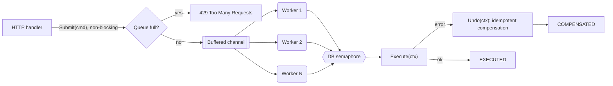

# ADR 001: Command Pattern and Worker Pool for Transactional Processing in Go

## Status
Accepted. **Extended by [ADR 003](003-persistence-outbox-sqlite.md)** (durable persistence, outbox, idempotency).

## Date
2026-10-21

## Business and Technical Context
The transactional backend of `fin-ai-advisor` (`portfolio-api`) must process large streams of buy and sell orders (`BuyOrder`, `SellOrder`) with low latency and high concurrency. During periods of high market volatility, thousands of clients submit orders at the same time.

The main architectural challenges are:
1. **Database connection starvation:** creating one goroutine and one PostgreSQL transaction per incoming request quickly exhausts the connection pool (e.g. `max_connections=100`), causing timeouts and cascading failures.
2. **Distributed transactional consistency (Saga pattern):** a financial transaction spans several steps (liquidity validation, capital reservation, broker execution, ledger settlement). If a later step fails, earlier steps need a formal compensation mechanism (`Undo`).
3. **Decoupling:** the order producer (HTTP controller / gRPC consumer) must not know execution details or hold network resources while the order is processed.

## Decision

### Decision at a glance



We adopt the **Command Pattern** combined with a **Worker Pool** built on goroutines and channels, following [Refactoring.Guru: Command Pattern](https://refactoring.guru/design-patterns/command).

### 1. Command Pattern (`internal/domain/trade_command.go`)
- A canonical `Command` interface:
  ```go
  type Command interface {
      Execute(ctx context.Context) error
      Undo(ctx context.Context) error
      ID() string
      Status() OrderStatus
  }
  ```
- Each order (e.g. `BuyOrder`) encapsulates its parameters (ID, PortfolioID, Symbol, Quantity, PriceCents) and its own state machine (`PENDING`, `EXECUTED`, `FAILED`, `COMPENSATED`).
- `Execute(ctx)` is a two-step saga: (1) reserve funds, (2) settle with the broker.
- `Undo(ctx)` compensates only when step 1 actually happened (it returns `ErrNothingToCompensate` otherwise) and is **idempotent**, so the saga can be retried safely.

### 2. Concurrent Worker Pool (`internal/engine/worker_pool.go`)
- A fixed pool of N workers (goroutines) consumes commands from a buffered channel.
- Submission is non-blocking (`select` with `default`) or uses a bounded timeout, applying **backpressure** when the queue is full (`HTTP 429 Too Many Requests`).
- A channel-based semaphore (`dbConnSemaphore`) caps concurrent database transactions below the number of workers.
- Lifecycle is managed with `context.Context`, `sync.WaitGroup` and an `RWMutex` that guards channel closing, so shutdown drains in-flight orders and producers can never send on a closed channel.

## Consequences and Trade-offs

### Positive (+)
- **Resource protection:** concurrent database transactions are strictly bounded, removing the risk of connection starvation.
- **Fault tolerance and reversibility:** the uniform `Undo()` enables automatic compensation when execution fails.
- **Auditability and telemetry:** every command has a traceable identifier, and the pool exposes atomic metrics (submitted, executed, failed, compensated, rejected, duplicates).

### Negative / Mitigations (−)
- **In-memory buffer:** queued commands live in volatile memory and are lost on a crash. *Mitigation:* [ADR 003](003-persistence-outbox-sqlite.md) persists every accepted order in a transactional outbox and re-dispatches it.
- **Compensation complexity:** `Undo()` must be idempotent under repeated failures. *Mitigation:* an atomic state check inside `Undo()`, covered by regression tests.

## Lessons learned (found by tests)
- A check-then-send race between `Submit` and `Shutdown` could panic with *send on closed channel*. Fixed with a read/write lock and a `quit` channel; regression test `TestWorkerPool_SubmitDuringShutdownDoesNotPanic`.
- Deriving the pool context from the OS signal context made SIGTERM drop queued orders instead of draining them. The pool now uses an independent context and is stopped explicitly by `Shutdown`.

## References
- Refactoring Guru: Command Design Pattern (<https://refactoring.guru/design-patterns/command>)
- Go Concurrency Patterns: Pipelines and cancellation (<https://go.dev/blog/pipelines>)
- Saga pattern for distributed transactions
