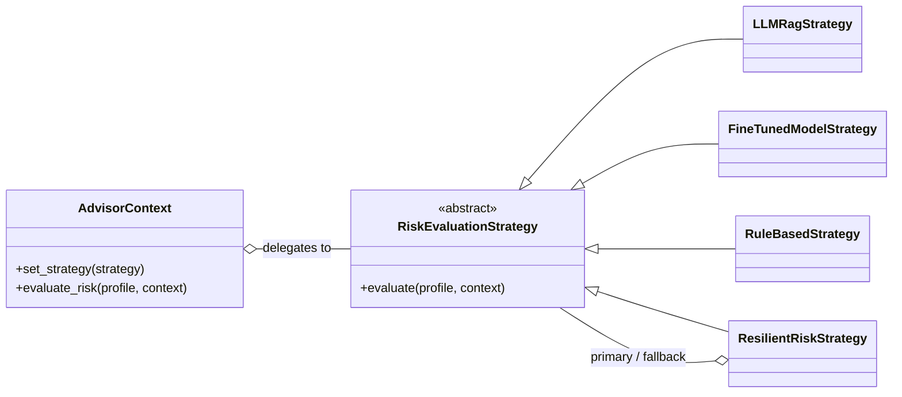

# ADR 002: Strategy Pattern for Risk Evaluation in the AI Service

## Status
Accepted. **Amended by [ADR 004](004-ai-advisory-guardrails-hitl-evals.md)** (2026-10-21).

> **Amendment (2026-10-21):** the core decision (Strategy Pattern + `AdvisorContext`) stands. These implementation details changed:
> - `LangChainOpenAIStrategy` became `LLMRagStrategy`, which is provider-agnostic through the `LLMClient` protocol (Claude with structured output, or a deterministic fake).
> - The sequential `rag_graph.py` was replaced by `graph.py`, a real LangGraph `StateGraph` with guardrails and human-in-the-loop.
> - The fallback when the LLM degrades is `RuleBasedStrategy`, wrapped in a circuit breaker (`ResilientRiskStrategy`). It is not the fine-tuned model, because a fallback should not depend on another inference component that can also fail.
> - Risk figures (VaR, volatility) are computed by a deterministic quantitative core, not by the model.
>
> The original text is kept below as a historical record. ADRs are amended, not rewritten.

## Date
2026-10-21

## Business and Technical Context
The AI service (`ai-service`) of `fin-ai-advisor` evaluates investment profiles, risk tolerance and portfolio suitability as macroeconomic and regulatory conditions change.

Functional and non-functional requirements:
1. **Heterogeneous models per use case:**
   - For clients with complex portfolios who need qualitative, explainable answers: a RAG (*Retrieval-Augmented Generation*) flow over market and policy documents.
   - For high-frequency, real-time evaluation or data-sovereignty constraints (on-premise / air-gapped VPC): a dedicated fine-tuned small language model (SLM) with predictable latency.
2. **Runtime interchangeability:** the advisor must switch strategies dynamically by account type, user SLA, external API quota or contingency mode (*fallback*).
3. **Maintainability and the Open/Closed Principle:** adding new AI providers or architectures must not change the advisor's business logic.

## Decision

### Decision at a glance



We adopt the **Strategy Pattern** in Python 3.11+, following [Refactoring.Guru: Strategy Pattern](https://refactoring.guru/design-patterns/strategy).

### 1. Strategy interface (`ai-service/src/strategy.py`)
- An abstract base class `RiskEvaluationStrategy` defines the contract:
  ```python
  class RiskEvaluationStrategy(ABC):
      @abstractmethod
      def evaluate(self, profile: PortfolioProfile, context: list[RetrievedChunk] | None = None) -> RiskAssessmentResult: ...
  ```
- Strict typing with Pydantic for inputs (`PortfolioProfile`) and outputs (`RiskAssessmentResult`), which provides schema validation at runtime.

### 2. Concrete strategies
- **LLM RAG strategy:** reasons over retrieved knowledge-base documents and returns qualitative analysis with citations.
- **Fine-tuned model strategy:** local or dedicated inference for risk classification, prioritizing deterministic latency and data sovereignty.

### 3. Context (`AdvisorContext`)
- Holds a reference to the active strategy.
- Accepts the strategy in its constructor or swaps it at runtime through `set_strategy()`.
- Provides unified telemetry (strategy used, risk score, latency).

## Consequences and Trade-offs

### Positive (+)
- **Open/Closed Principle:** adding a new provider (e.g. a Bedrock or local model strategy) does not modify `AdvisorContext`.
- **Testability:** mock strategies and a fake LLM can be injected in CI without token cost or network latency.
- **Operational resilience:** when the external LLM degrades, the system switches to a fallback strategy (see the amendment: rule-based, behind a circuit breaker).

### Negative / Mitigations (−)
- **Output normalization:** different models can produce score distributions on different scales. *Mitigation:* a strict `RiskAssessmentResult` schema with scores normalized to 0.0–1.0.

## References
- Refactoring Guru: Strategy Design Pattern (<https://refactoring.guru/design-patterns/strategy>)
- LangGraph documentation: stateful multi-actor applications with LLMs
- PEP 544 – Protocols: structural subtyping
