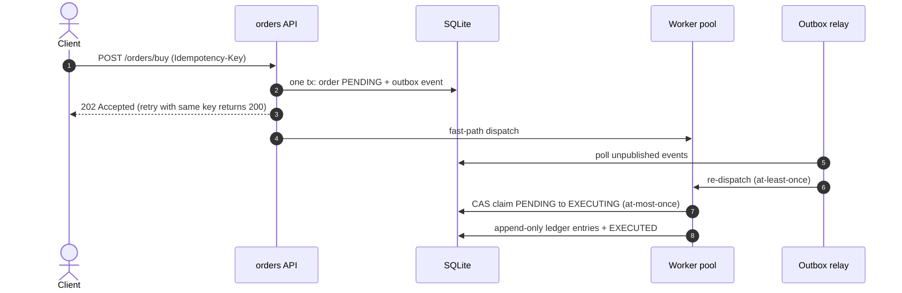

# ADR 003: Transactional Persistence with Outbox, Append-Only Ledger and SQLite

## Status
Accepted

## Date
2026-10-21

## Context
The worker pool from [ADR 001](001-command-worker-pool-go.md) queued orders in memory only. That left three open problems:

1. **Durability:** if the process crashed between accepting an order (HTTP 202) and executing it, the order was lost without a trace.
2. **Client retries:** a network timeout made the client resend the order, and it executed twice (double charge).
3. **Money representation:** amounts were `float64`, with rounding errors that are unacceptable in finance (`0.1 + 0.2 != 0.3`).

## Decision

### Decision at a glance

### 1. Transactional outbox
`POST /orders/buy` inserts the order (`PENDING`) **and** an `OrderAccepted` event into the `outbox` table in **one transaction**. It then tries to dispatch to the worker pool (fast path). A periodic **relay** re-dispatches events that are still unpublished (pool saturated or process crashed).

- **At-least-once delivery:** an order may reach the pool twice (fast path + relay).
- **At-most-once execution:** the worker claims the order with a compare-and-set, `UPDATE orders SET status='EXECUTING' WHERE id=? AND status='PENDING'`. Only one worker gets `RowsAffected = 1`; the others discard the delivery as a duplicate.

### 2. Idempotency-Key
The client sends an `Idempotency-Key` header. `orders.idempotency_key` is `UNIQUE`, so a retry returns the original order (HTTP 200) instead of creating a new one.

### 3. Append-only ledger
Movements (`CASH_DEBIT`, `POSITION_CREDIT`, `FUNDS_RESERVED`, `FUNDS_RELEASED`) are inserted into `ledger_entries` and **never modified**: triggers abort any `UPDATE` or `DELETE`. Positions are derived with `SUM(amount) GROUP BY asset`.

- This avoids locking a shared "balance" row on every write (write-lock contention).
- It provides a complete audit trail. A saga compensation is recorded as a reversing entry, never as a deletion.

### 4. Money as integers
Prices are stored in cents (`INTEGER`) and quantities in whole shares. The API accepts prices as decimal strings (`"185.50"`) and parses them without going through `float`.

### 5. Decorator for persistence
`orders.persistentOrder` implements `domain.Command` by wrapping `domain.BuyOrder`. The domain stays pure (no SQL), and the worker pool cannot tell the two apart.

### 6. SQLite (`modernc.org/sqlite` driver, pure Go)
- No cgo and no containers: the project runs and is tested with `go test` on any machine and in CI.
- WAL mode + `busy_timeout` + `_txlock=immediate` to handle single-writer concurrency.
- All SQL lives in `internal/store` behind interfaces (`orders.Repository`, `httpapi.Reader`).

## Consequences

### Positive (+)
- No accepted order is lost on a crash, and client retries are safe.
- Invariants are enforced by the database (`CHECK`, `UNIQUE`, triggers), not only by code.
- Real integration tests (one temporary database per test) with no external dependencies.

### Negative / Mitigations (−)
- **SQLite has a single writer:** write throughput is limited. *Mitigation:* production uses PostgreSQL (RDS, already provisioned in `infra/`). Only the `store` package changes: `SELECT ... FOR UPDATE SKIP LOCKED` in the relay, `NUMERIC(20,4)` or `BIGINT` for money, and a larger connection pool.
- **Relay latency:** a deferred order waits up to `relayInterval + relayMinAge` (~7 s). This is acceptable because the API is already asynchronous (202 + polling `GET /orders/{id}`).
- **Failure to persist after the broker executes:** the order stays in `EXECUTING`. *Pending mitigation:* a reconciliation job that checks the broker for `EXECUTING` orders older than N minutes.

## Alternatives considered
- **Publishing directly to Kafka/SQS from the handler:** suffers from the *dual write* problem (the database commits and the broker fails, or the reverse). The outbox solves it with a single local transaction.
- **A balance row with `UPDATE balance = balance - x`:** simpler, but it serializes writes per portfolio and loses history.
- **PostgreSQL from day one:** it is the production target, but it requires Docker for development and CI. For the current scope, SQLite maximizes reproducibility.
