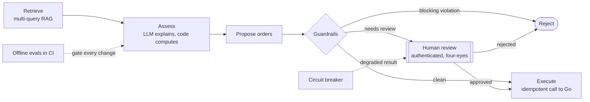

# ADR 004: AI Advisory — LangGraph Workflow, Guardrails, Human-in-the-Loop and Offline Evaluation

## Status
Accepted

## Date
2026-10-21

## Context
The AI service produces rebalancing recommendations that become real orders. In a regulated domain (financial advice), a prototype built as "LLM + prompt" leaves these risks uncovered:

1. **Hallucinations:** the model may invent sources or figures.
2. **Suitability:** a technically coherent recommendation can still be unsuitable for the client (e.g. crypto for a conservative profile).
3. **Excessive agency:** an LLM must not be able to move money on its own.
4. **Availability:** the LLM provider can degrade or fail.
5. **Silent regressions:** a prompt, model or retriever change can lower quality without any unit test failing.

## Decision

### Decision at a glance

### 1. A deterministic workflow, not an autonomous agent
Orchestration is a LangGraph `StateGraph` with explicit nodes and edges (`retrieve → assess → propose → guardrails → {reject | human_review | execute}`). The LLM takes part in **one node only** (assessment) and does not decide the control flow. An autonomous agent with tools is not justified: the steps are known in advance and the cost of an error is high.

### 2. "The LLM explains, the code computes"
Volatility, VaR (parametric, scaled by √t) and concentration are computed by a deterministic quantitative core. The LLM receives those numbers as context and returns a **structured** opinion (`LLMRiskOpinion`, validated with Pydantic; with Claude, `messages.parse` with `output_format`). Any output that does not match the schema counts as a failure. A hash of the system prompt (`PROMPT_VERSION`) is recorded on every assessment.

### 3. RAG with verifiable citations
The knowledge base is split into chunks with a stable `chunk_id`. Retrieval uses **multi-query + Reciprocal Rank Fusion**: one sub-query per concern in the profile, because concatenating them diluted the signal (a defect found by the evals). The model must cite `chunk_id`s, and the guardrails check that every citation was actually retrieved (*groundedness*).

### 4. Two-level guardrails
- **Blocking** (the recommendation is rejected): hallucinated citations, an allocation that does not sum to 1, crypto for unsuitable profiles or above 5%, a risk level that contradicts the declared tolerance, unfunded purchases.
- **Human review** (the graph pauses): risk score ≥ 0.70, a trade > 10% of AUM, a single-security position > 20%, a degraded result, or **insufficient context** (the investment policy was not retrieved).

### 5. Human-in-the-loop with `interrupt()`
The `human_review` node pauses the graph and persists its state in the checkpointer. An advisor approves or rejects through `POST /v1/advice/{id}/review`, and the graph resumes with `Command(resume=...)`.
- Reviewers authenticate with a bearer token, and their identity comes from the token, never from the request body.
- **Four-eyes:** the client that requested an advice cannot approve it.

Today the checkpointer is `MemorySaver`. The state is plain JSON, so moving to a Postgres checkpointer needs no model changes.

### 6. Resilience
`ResilientRiskStrategy` (Decorator) wraps the LLM strategy with a circuit breaker (CLOSED → OPEN → HALF_OPEN). While the circuit is open, the rule-based strategy answers. The result is flagged `degraded`, which forces human review: availability is never bought at the expense of control.

### 7. Idempotent cross-service execution
The `execute` node sends orders to `portfolio-api` with `Idempotency-Key = <thread_id>:<i>:<symbol>`. If the graph is retried or resumed twice, the backend returns the original order instead of duplicating it (see [ADR 003](003-persistence-outbox-sqlite.md)).

### 8. Offline evaluation as a quality gate
A golden set with normal and **adversarial** cases (hallucinated citations, unsuitable advice, provider outage, indirect prompt injection through a poisoned document) runs in CI. It measures route accuracy, retrieval recall, groundedness, policy compliance, guardrail catch rate and p95 latency, and the pipeline fails if any metric drops below its threshold. By default it uses a deterministic fake LLM (zero cost, reproducible); with `LLM_PROVIDER=anthropic` it evaluates the real model.

### 9. Observability
Per-node latency, prompt version and strategy are exposed on every run, plus one JSON log line per event without personal data. `GET /metrics` reports the fallback rate, guardrail block rate, human review rate and human override rate.

### 10. Distilled fine-tuning dataset
Labels in the synthetic dataset come from applying the quantitative pipeline (the teacher) to each generated portfolio, instead of a fixed table per archetype, which would only teach the model to memorize the archetype. A CI quality gate requires zero duplicates and label variability within each archetype.

## Consequences

### Positive (+)
- Every risk in the context has a verifiable control and a golden-set case that demonstrates it.
- Tests and evals run without network or cost; switching LLM providers only requires implementing `LLMClient`.
- Quality defects are caught before merge, not in production. The first eval run found two real bugs: query dilution in retrieval, and broad ETFs counted as single-stock concentration.

### Negative / Mitigations (−)
- **The fake LLM does not measure the real model's quality:** it measures the system around the model. *Mitigation:* the same harness runs against Claude on demand (at a cost) before changing models or prompts.
- **TF-IDF does not capture synonyms.** *Mitigation:* the `Embedder` interface allows dense embeddings and pgvector in production, validated with the same golden set.
- **Small golden set (9 cases):** enough as a regression gate, not as a statistical measure. *Mitigation:* grow it with anonymized real cases, using human review decisions as labels.
- **`MemorySaver` loses pending reviews on restart.** *Mitigation:* a persistent checkpointer (Postgres) before production.
- **In-memory rate limiter and token map:** single-node only. *Mitigation:* move rate limiting to the API gateway or Redis, and reviewer identity to the identity provider (JWT/OIDC).

## References
See [docs/patterns-and-references.md](../patterns-and-references.md) for the book chapters behind each decision.
