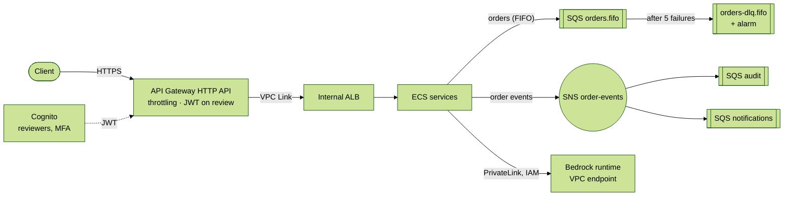

# ADR 005: AWS Managed Services for the Edge, Messaging and Model Access

## Status

Accepted. Infrastructure implemented and tested; application integration pending (see "Implementation status").

## Date

2026-10-25

## Context

The architecture had several gaps that were documented in earlier ADRs and READMEs. Each one is a problem a managed AWS service solves directly:

| Gap | Where it was documented | Consequence |
|---|---|---|
| The order queue is a Go channel **in one process's memory** | ADR 001 | Several replicas cannot share work; a crash loses queued items (mitigated by the outbox) |
| A failed saga **compensation only leaves a log line** | `portfolio-api/README.md` | No retry, no place to investigate failed messages |
| No **publish/subscribe** for order events | Design-patterns review (Observer missing) | The worker pool updates metrics and logs itself; adding a consumer means changing the pool |
| The **rate limiter and reviewer tokens live in memory** | ADR 004 | They only work on a single node; reviewer identity is not an identity provider |
| The ALB is **internet-facing** | `infra/README.md` | Public ingress on 80/443 is an accepted risk (Trivy AVD-AWS-0053, AVD-AWS-0107) |
| The AI service reaches the LLM **over the internet** | `infra/README.md` | The only egress to `0.0.0.0/0` (TCP 443) is an accepted risk (AVD-AWS-0104); the API key lives in Secrets Manager |

The rule for this decision: **a service is added only if it closes one of these gaps.** Services that would only add surface area (for example Step Functions to orchestrate a saga that is already correct in-process) are rejected.

## Decision

### Decision at a glance

### 1. API Gateway (HTTP API) as the only public entry point (`infra/modules/api-gateway`)

- A **VPC Link** connects API Gateway to the ALB, which becomes **internal** and moves to the private subnets. Its security group accepts traffic **only from the VPC Link security group**; the internet ingress rules are removed.
- **Managed throttling** on the stage (steady rate and burst), shared by every replica, replacing the role of the in-memory rate limiter at the edge.
- A **JWT authorizer** backed by a **Cognito user pool** protects `POST /v1/advice/{thread_id}/review`. Reviewers are provisioned by an administrator (no self sign-up), MFA is required, and the password policy is strict.
- **JSON access logs** for every request.

*Why an HTTP API and not a REST API:* lower latency and cost, native JWT authorizers and VPC Link to an ALB. The REST API's extra features (request validation models, usage plans with API keys, edge caching) are not needed here.

### 2. SQS FIFO order queue with a dead-letter queue (`infra/modules/messaging`)

- **FIFO**, with `MessageGroupId = portfolio_id`: orders of one portfolio stay in sequence while different portfolios are processed in parallel. Deduplication and throughput are scoped per message group.
- **`MessageDeduplicationId = Idempotency-Key`**: a retried order is dropped for 5 minutes. The database `UNIQUE(idempotency_key)` constraint still guards beyond that window.
- After **5 failed receives** a message moves to the **DLQ**, which keeps it for 14 days and triggers an alarm. This is where failed compensations would go.
- **Long polling** (20 s) to cut empty receives.

*Why FIFO and not standard:* per-portfolio ordering and deduplication match the domain. The throughput limit of FIFO queues is far above the order volume of an advisory platform.

### 3. SNS fan-out for order events (`infra/modules/messaging`)

- One topic, `order-events`, with **one SQS queue per subscriber** (`audit`, `notifications`), each with its own DLQ and alarm.
- **Raw message delivery**: subscribers receive the event itself, not an SNS envelope.
- Each queue policy accepts messages **only from this topic** (`aws:SourceArn`).
- This is the distributed version of the Observer pattern: adding a consumer is adding a queue, not changing the producer.

### 4. Bedrock through a private endpoint (`infra/modules/bedrock-access`)

- An **interface VPC endpoint** for `bedrock-runtime` with private DNS, reachable only from the ECS security group on 443. Traffic to the model stays on the AWS network.
- The task role may call **`bedrock:InvokeModel` and `bedrock:InvokeModelWithResponseStream` on Anthropic foundation models only**. Authentication is IAM: no API key.
- Bedrock also offers embedding models, so the target RAG stack can stay inside AWS: **Bedrock embeddings → pgvector on RDS → Claude on Bedrock**.

### 5. Shared rules

- Everything in the messaging module is encrypted with **one customer-managed KMS key** whose policy lets SNS deliver to the encrypted queues (without that statement, deliveries are dropped silently).
- The task role receives **only** the permissions the integration needs: send/receive/delete on the order queue, publish on the topic, and use of the messaging key.

## Implementation status

| Component | Status | Tested by |
|---|---|---|
| SQS FIFO queue, DLQ, redrive, alarms | ✅ Infrastructure | `terraform test` + LocalStack (deduplication, DLQ redrive and fan-out exercised for real) |
| SNS topic, subscriber queues, queue policies | ✅ Infrastructure | `terraform test` + LocalStack (an event published to the topic reaches every subscriber queue) |
| API Gateway, VPC Link, Cognito, internal ALB | ✅ Infrastructure | `terraform test` (API Gateway v2 and Cognito need LocalStack Pro) |
| Bedrock endpoint and invoke permission | ✅ Infrastructure | `terraform test` |
| portfolio-api producing to and consuming from SQS | ⬜ Pending | Replaces the in-process channel; the outbox relay becomes the SQS producer |
| Publishing order events to SNS | ⬜ Pending | Emitted when an order is executed, compensated or fails compensation |
| Reviewer identity from the JWT claims | ⬜ Pending | Replaces the in-memory reviewer tokens |
| `BedrockLLMClient` adapter behind `LLMClient` | ⬜ Pending | New adapter; the rest of the AI service does not change |

## Consequences

### Positive (+)

- Four documented gaps are closed at the infrastructure level, and two accepted risks disappear once the application is integrated: public ALB ingress (already removed) and internet egress for the LLM.
- The order queue survives restarts and is shared by any number of replicas; poison messages are isolated with an alarm.
- New consumers of order events need no change to the producer.
- Reviewer identity comes from an identity provider with MFA.

### Negative / Mitigations (−)

- **More managed services to pay for and understand.** *Mitigation:* each one is justified by a documented gap; nothing was added for its own sake.
- **FIFO deduplication lasts 5 minutes.** *Mitigation:* the database idempotency constraint remains the source of truth.
- **API Gateway adds latency** (a few milliseconds) and has a 29-second integration timeout. *Mitigation:* the APIs are asynchronous (`202 Accepted`), so no request needs to run that long.
- **Bedrock model availability varies by region.** *Mitigation:* the region and model pattern are variables; the invoke permission can be narrowed to one model ID.
- **Infrastructure ahead of the application.** *Mitigation:* the status table above states exactly what is wired and what is not.

## Alternatives considered

- **Step Functions for the saga:** rejected. The two-step saga is correct and tested in-process; moving it would duplicate logic without closing a gap.
- **Amazon MQ or MSK (Kafka) instead of SQS/SNS:** rejected for now. They fit high-throughput streaming and replay, but add brokers to operate; SQS and SNS are serverless and enough for this volume.
- **ElastiCache (Redis) for the rate limiter and the review checkpointer:** a good fit for shared state, deferred. API Gateway already covers edge throttling; the persistent checkpointer can use PostgreSQL.
- **SageMaker for the fine-tuned model:** a good conceptual fit for `FineTunedModelStrategy` (training job, model registry, endpoint), deferred because there is no trained model yet and an endpoint has a standing cost.
- **REST API instead of HTTP API:** rejected; see section 1.

## References

- [ADR 001](001-command-worker-pool-go.md) (in-memory queue) · [ADR 003](003-persistence-outbox-sqlite.md) (outbox, idempotency) · [ADR 004](004-ai-advisory-guardrails-hitl-evals.md) (reviewer identity, rate limiting)
- AWS documentation: HTTP API private integrations with VPC Link; SQS FIFO queues and dead-letter queues; SNS fan-out to SQS; Bedrock interface VPC endpoints
