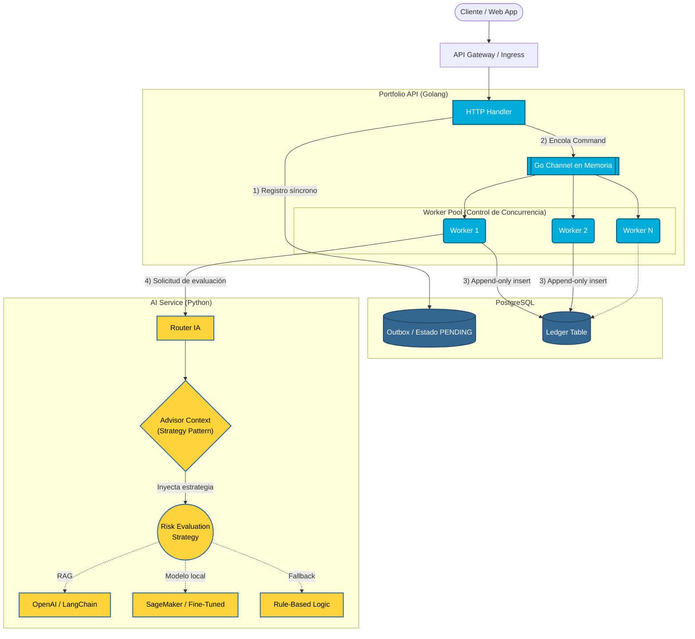
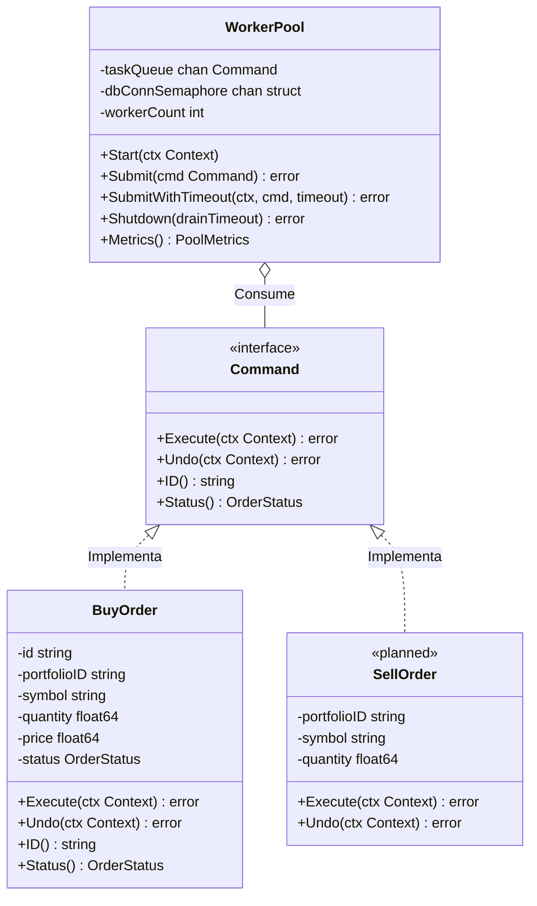
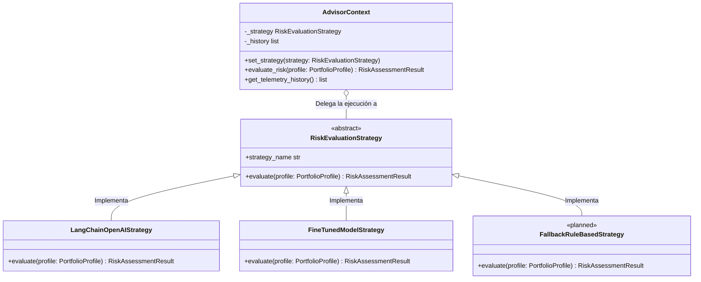
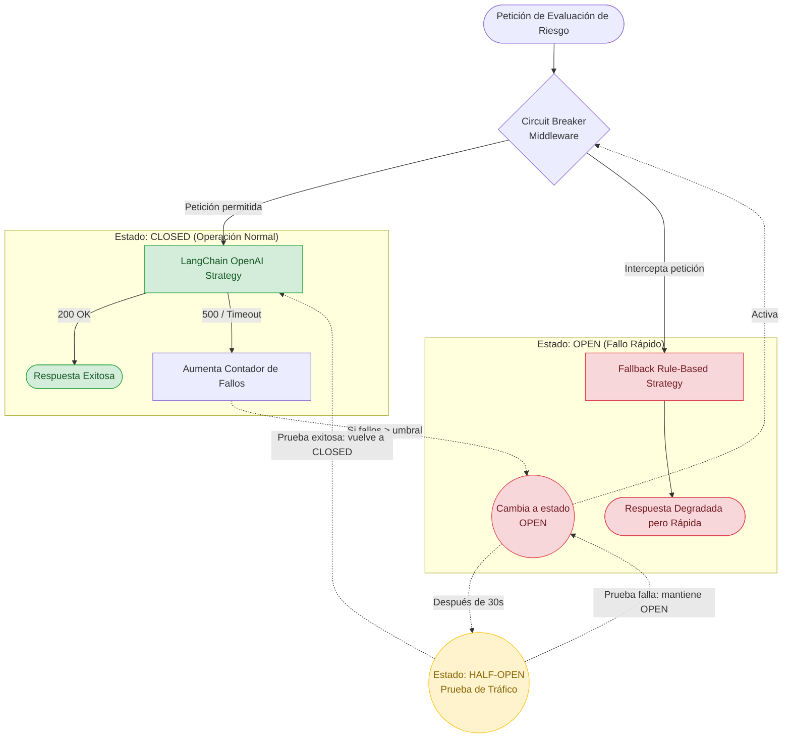
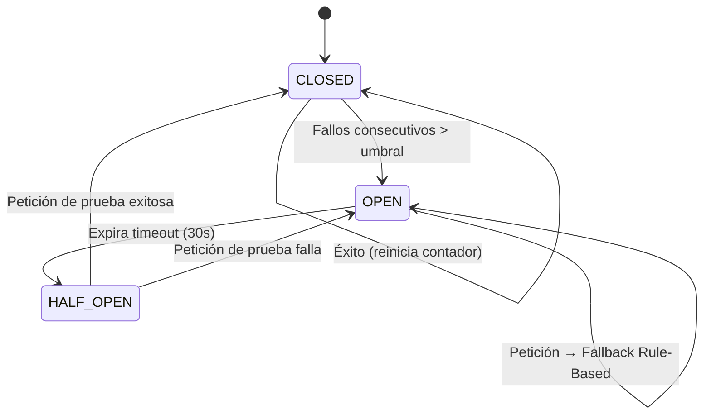

# Diseño de Arquitectura — Fin-AI Advisor

Este documento reúne los diagramas de arquitectura del monorepo. Cada diagrama va acompañado de una tabla de **estado de implementación** que distingue lo que existe hoy en el código de lo que forma parte de la arquitectura objetivo (roadmap).

| Leyenda | Significado |
|---|---|
| ✅ Implementado | Existe en el código y tiene pruebas |
| 🟡 Simulado | Existe la interfaz/clase, pero la lógica es un stub determinista (sin llamadas reales a LLM, BD o red) |
| ⬜ Objetivo | Parte de la arquitectura objetivo; aún no implementado |

Decisiones relacionadas: [ADR 001](adr/001-command-worker-pool-go.md) · [ADR 002](adr/002-strategy-pattern-ai-python.md)

---

## 1. Arquitectura General y Flujo de Transacciones

| Componente | Estado | Ubicación |
|---|---|---|
| HTTP Handler (`POST /api/v1/orders/buy`, `/metrics`, `/health`) | ✅ | [`cmd/api/main.go`](../portfolio-api/cmd/api/main.go) |
| Go Channel con búfer + backpressure (HTTP 429) | ✅ | [`internal/engine/worker_pool.go`](../portfolio-api/internal/engine/worker_pool.go) |
| Worker Pool + semáforo de conexiones BD | ✅ | [`internal/engine/worker_pool.go`](../portfolio-api/internal/engine/worker_pool.go) |
| API Gateway / ALB | ⬜ | No provisionado en [`infra/main.tf`](../infra/main.tf) |
| Outbox (estado PENDING persistido) | ⬜ | La orden vive solo en memoria |
| Ledger append-only en PostgreSQL | ⬜ | La persistencia se simula con `time.Sleep` |
| Llamada Worker → AI Service | ⬜ | No existe cliente HTTP entre servicios |
| Router IA (API HTTP del servicio Python) | ⬜ | `ai-service` no expone endpoints |
| Advisor Context + Strategy | ✅ | [`ai-service/src/strategy.py`](../ai-service/src/strategy.py) |
| Estrategia OpenAI / LangChain (RAG) | 🟡 | `LangChainOpenAIStrategy` |
| Estrategia Fine-Tuned (SageMaker) | 🟡 | `FineTunedModelStrategy` (inferencia local simulada) |
| Estrategia Rule-Based (fallback) | ⬜ | Ver diagrama 4 |

---

## 2. Command Pattern: Encapsulación de Órdenes (Golang)

| Componente | Estado | Ubicación |
|---|---|---|
| Interfaz `Command` + `BuyOrder` (máquina de estados PENDING → EXECUTED / FAILED → COMPENSATED) | ✅ | [`internal/domain/trade_command.go`](../portfolio-api/internal/domain/trade_command.go) |
| `SellOrder` | ⬜ | — |
| `WorkerPool` (Submit no bloqueante, compensación automática vía `Undo`) | ✅ | [`internal/engine/worker_pool.go`](../portfolio-api/internal/engine/worker_pool.go) |

---

## 3. Strategy Pattern: Abstracción de Modelos IA (Python)

| Componente | Estado | Ubicación |
|---|---|---|
| `RiskEvaluationStrategy` (ABC) + `AdvisorContext` con cambio en runtime y telemetría | ✅ | [`ai-service/src/strategy.py`](../ai-service/src/strategy.py) |
| `LangChainOpenAIStrategy` | 🟡 | Scoring determinista por tolerancia; no invoca LangChain ni OpenAI |
| `FineTunedModelStrategy` (destino: endpoint SageMaker) | 🟡 | VaR paramétrico calculado localmente |
| `FallbackRuleBasedStrategy` | ⬜ | — |
| Pipeline RAG de 4 nodos | 🟡 | [`ai-service/src/rag_graph.py`](../ai-service/src/rag_graph.py) — ejecución secuencial, documentos fijos |

---

## 4. Resiliencia: Circuit Breaker y Degradación Elegante

### 4.1 Flujo de peticiones

### 4.2 Máquina de estados

| Componente | Estado | Ubicación |
|---|---|---|
| Circuit Breaker middleware | ⬜ | — |
| Fallback Rule-Based | ⬜ | — |

Versión en inglés: [diagrams/circuit_breaker_en.md](diagrams/circuit_breaker_en.md)
