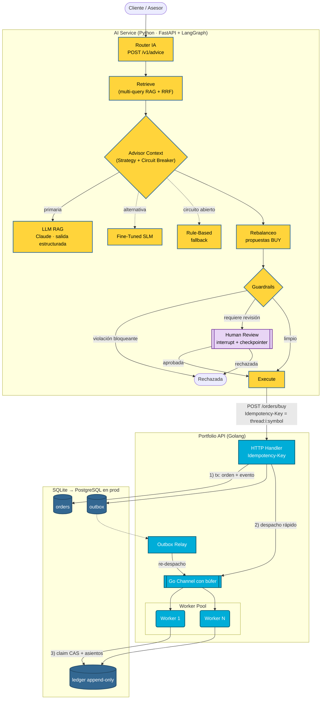
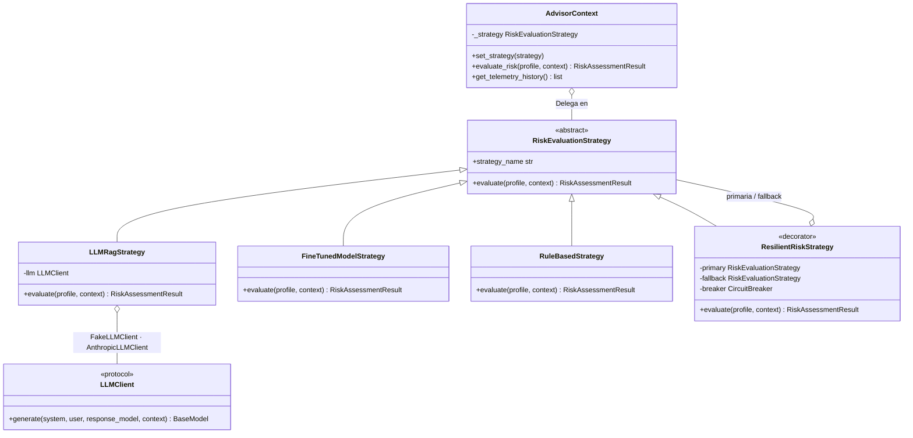
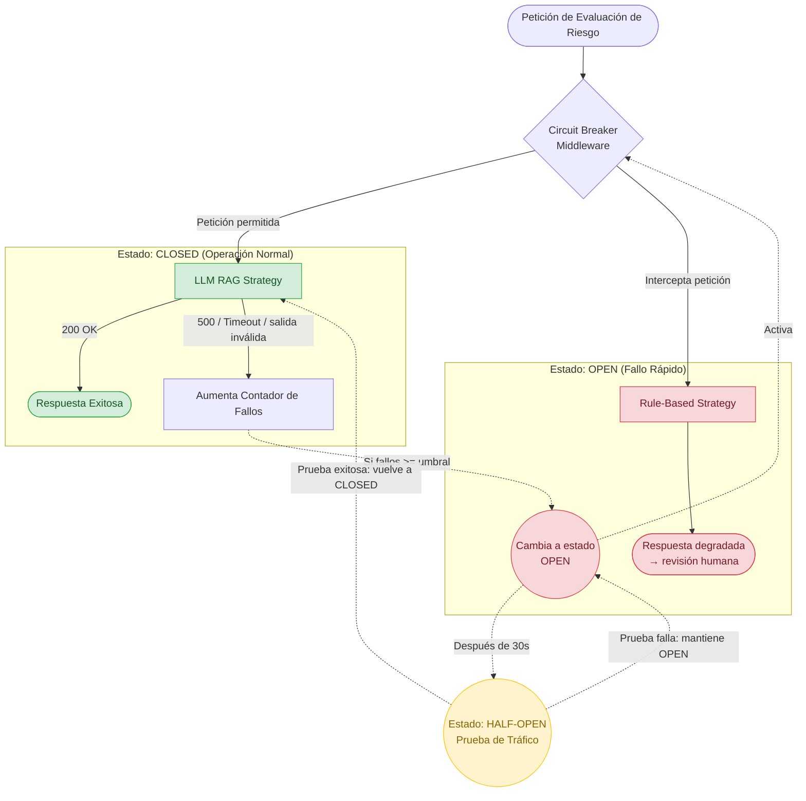
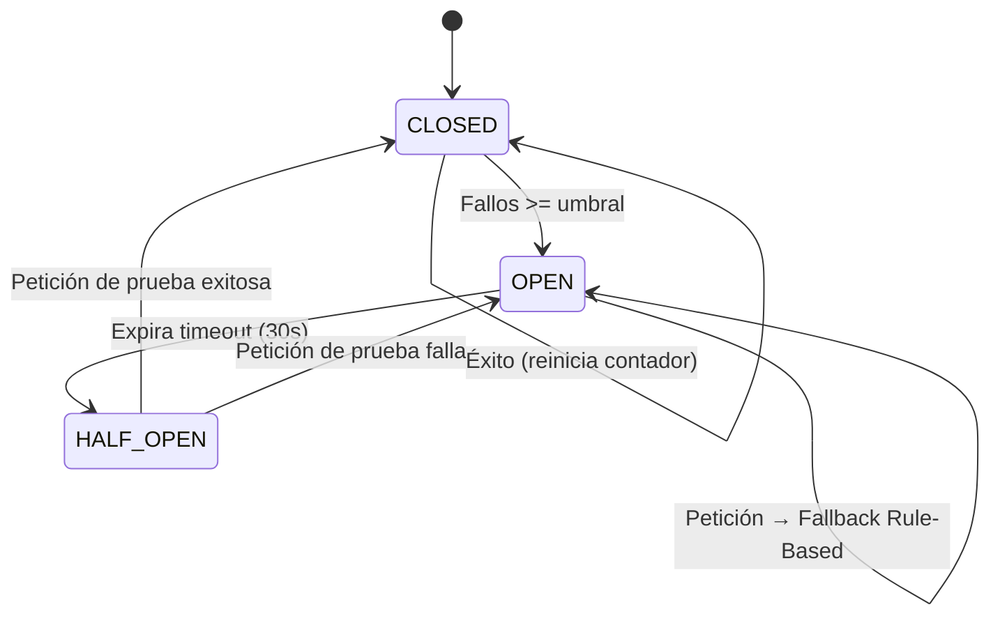

# Diseño de Arquitectura — Fin-AI Advisor

Este documento reúne los diagramas de arquitectura del monorepo. Cada diagrama va acompañado de una tabla de **estado de implementación** que distingue lo que existe hoy en el código de lo que forma parte de la arquitectura objetivo (roadmap).

| Leyenda | Significado |
|---|---|
| ✅ Implementado | Existe en el código y tiene pruebas |
| 🟡 Simulado | Existe la interfaz/clase con el contrato real, pero la lógica es un stub determinista |
| ⬜ Objetivo | Parte de la arquitectura objetivo; aún no implementado |

Decisiones relacionadas: [ADR 001](adr/001-command-worker-pool-go.md) · [ADR 002](adr/002-strategy-pattern-ai-python.md) · [ADR 003](adr/003-persistence-outbox-sqlite.md) · [ADR 004](adr/004-ai-advisory-guardrails-hitl-evals.md)

---

## 1. Arquitectura General y Flujo de Transacciones

La IA **propone** y nunca ejecuta directamente. Las órdenes pasan por guardrails y, cuando corresponde, por aprobación humana, antes de llegar al backend transaccional. Este las procesa de forma durable e idempotente. La latencia y la disponibilidad del LLM nunca bloquean el camino de ejecución de órdenes.

| Componente | Estado | Ubicación |
|---|---|---|
| Router IA (FastAPI: advice, review, health) | ✅ | [`ai-service/src/api.py`](../ai-service/src/api.py) |
| Grafo LangGraph con routing condicional y human-in-the-loop | ✅ | [`ai-service/src/graph.py`](../ai-service/src/graph.py) |
| RAG multi-query con Reciprocal Rank Fusion y citas por chunk | ✅ | [`ai-service/src/retrieval.py`](../ai-service/src/retrieval.py) — TF-IDF determinista; embeddings densos + pgvector en prod |
| Guardrails (groundedness, suitability, financiamiento, revisión) | ✅ | [`ai-service/src/guardrails.py`](../ai-service/src/guardrails.py) |
| Ejecución idempotente AI → Go | ✅ | `PortfolioApiExecutor` en [`graph.py`](../ai-service/src/graph.py) (DryRun por defecto) |
| HTTP Handler (`POST /orders/buy` con `Idempotency-Key`, `GET /orders/{id}`, `GET /portfolios/{id}/positions`) | ✅ | [`internal/httpapi/handler.go`](../portfolio-api/internal/httpapi/handler.go) |
| Go Channel con búfer + backpressure (HTTP 429) | ✅ | [`internal/engine/worker_pool.go`](../portfolio-api/internal/engine/worker_pool.go) |
| Outbox transaccional + relay de recuperación | ✅ | [`internal/store`](../portfolio-api/internal/store/store.go), [`internal/orders/relay.go`](../portfolio-api/internal/orders/relay.go) ([ADR 003](adr/003-persistence-outbox-sqlite.md)) |
| Ledger append-only (triggers anti UPDATE/DELETE) | ✅ | [`migrations/001_init.sql`](../portfolio-api/internal/store/migrations/001_init.sql) |
| Claim compare-and-set (ejecución at-most-once) | ✅ | `store.ClaimOrder` + decorator [`orders/persistent_order.go`](../portfolio-api/internal/orders/persistent_order.go) |
| Checkpointer persistente (Postgres/Redis) para revisiones de larga duración | ⬜ | Hoy `MemorySaver`; el estado ya es JSON-serializable |
| API Gateway / ALB | ⬜ | No provisionado en [`infra/main.tf`](../infra/main.tf) |

---

## 2. Command Pattern: Encapsulación de Órdenes (Golang)

| Componente | Estado | Ubicación |
|---|---|---|
| Interfaz `Command` + `BuyOrder` (Saga de dos pasos: reserva → liquidación; `Undo` idempotente) | ✅ | [`internal/domain/trade_command.go`](../portfolio-api/internal/domain/trade_command.go) |
| Decorator de persistencia (claim CAS, ledger, compensación) | ✅ | [`internal/orders/persistent_order.go`](../portfolio-api/internal/orders/persistent_order.go) |
| `WorkerPool` (Submit no bloqueante, drenado ordenado sin pérdida, descarte de duplicados) | ✅ | [`internal/engine/worker_pool.go`](../portfolio-api/internal/engine/worker_pool.go) |
| `SellOrder` | ⬜ | — |

---

## 3. Strategy Pattern: Abstracción de Modelos IA (Python)

| Componente | Estado | Ubicación |
|---|---|---|
| `RiskEvaluationStrategy` + `AdvisorContext` (cambio en runtime, telemetría) | ✅ | [`ai-service/src/strategy.py`](../ai-service/src/strategy.py) |
| Núcleo cuantitativo (volatilidad con correlaciones, VaR paramétrico √t) | ✅ | `compute_portfolio_metrics`: las cifras las calcula el código, nunca el LLM |
| `LLMRagStrategy` con salida estructurada validada (Pydantic) | ✅ | Claude (`claude-opus-5-5`, `messages.parse`) con `LLM_PROVIDER=anthropic`; fake determinista en CI |
| `RuleBasedStrategy` (fallback) | ✅ | Siempre disponible, sin dependencias externas |
| `FineTunedModelStrategy` | 🟡 | Contrato real; inferencia simulada. Dataset destilado en [`scripts/generate_finetuning_dataset.py`](../ai-service/scripts/generate_finetuning_dataset.py) |

---

## 4. Resiliencia: Circuit Breaker y Degradación Elegante

### 4.1 Flujo de peticiones

### 4.2 Máquina de estados

| Componente | Estado | Ubicación |
|---|---|---|
| Circuit Breaker (CLOSED / OPEN / HALF_OPEN, reloj inyectable para tests) | ✅ | [`ai-service/src/resilience.py`](../ai-service/src/resilience.py) |
| Fallback Rule-Based con marca `degraded` → revisión humana obligatoria | ✅ | `ResilientRiskStrategy` + regla en [`guardrails.py`](../ai-service/src/guardrails.py) |

---

## 5. Evaluación Offline (Quality Gate de IA)

| Métrica | Qué mide | Umbral en CI |
|---|---|---|
| `route_accuracy` | El grafo llega al estado esperado (ejecutar / revisar / rechazar) | 1.00 |
| `retrieval_recall` | Documentos requeridos presentes en el contexto recuperado | ≥ 0.90 |
| `groundedness` | Todas las citas corresponden a chunks recuperados | 1.00 |
| `policy_compliance` | Ninguna clase de activo prohibida en la recomendación | 1.00 |
| `guardrail_catch_rate` | Casos adversariales (alucinación, recomendación no apta, caída) neutralizados | 1.00 |

Golden set: [`ai-service/evals/golden_set.json`](../ai-service/evals/golden_set.json). Runner: [`ai-service/evals/run_evals.py`](../ai-service/evals/run_evals.py).

Versión en inglés del circuit breaker: [diagrams/circuit_breaker_en.md](diagrams/circuit_breaker_en.md)
