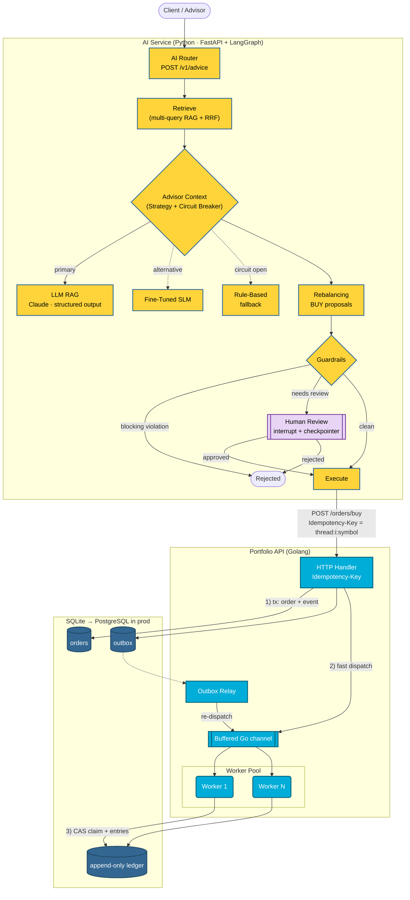
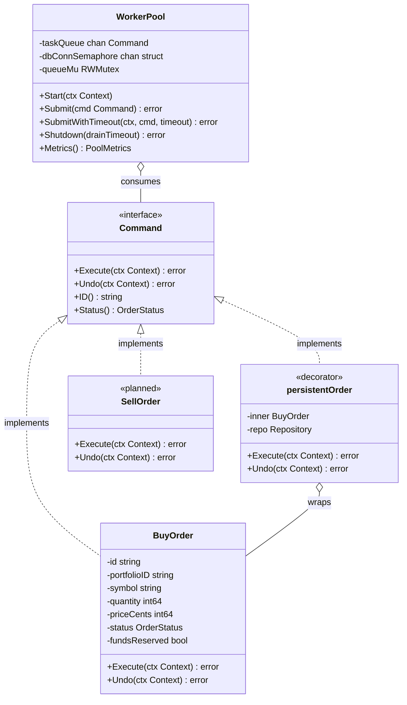
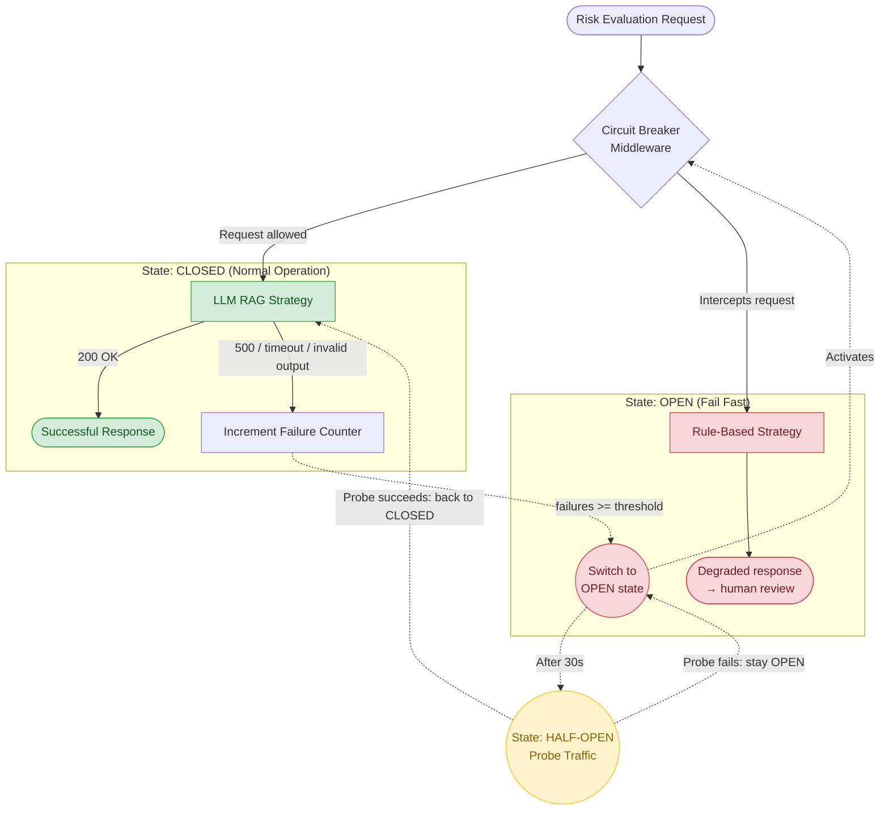
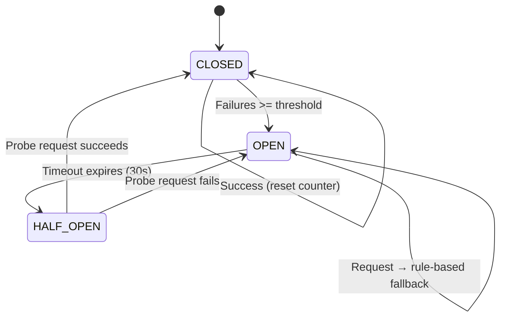

# Architecture Design — Fin-AI Advisor

This document collects the monorepo's architecture diagrams. Each diagram comes with an **implementation status** table that separates what exists in the code today from what belongs to the target architecture (roadmap).

| Legend | Meaning |
|---|---|
| ✅ Implemented | Exists in the code and is covered by tests |
| 🟡 Simulated | The interface/class with the real contract exists, but the logic is a deterministic stub |
| ⬜ Target | Part of the target architecture; not implemented yet |

Related decisions: [ADR 001](adr/001-command-worker-pool-go.md) · [ADR 002](adr/002-strategy-pattern-ai-python.md) · [ADR 003](adr/003-persistence-outbox-sqlite.md) · [ADR 004](adr/004-ai-advisory-guardrails-hitl-evals.md)

---

## 1. System Overview and Transaction Flow

The AI **proposes**; it never executes directly. Orders go through guardrails and, when required, human approval before reaching the transactional backend, which processes them durably and idempotently. LLM latency or availability never blocks the order execution path.

| Component | Status | Location |
|---|---|---|
| AI Router (FastAPI: advice, authenticated review, metrics, health) | ✅ | [`ai-service/src/api.py`](../ai-service/src/api.py) |
| LangGraph graph with conditional routing and human-in-the-loop | ✅ | [`ai-service/src/graph.py`](../ai-service/src/graph.py) |
| Multi-query RAG with Reciprocal Rank Fusion and per-chunk citations | ✅ | [`ai-service/src/retrieval.py`](../ai-service/src/retrieval.py). Deterministic TF-IDF; dense embeddings + pgvector in production |
| Guardrails (groundedness, suitability, funding, review triggers, insufficient context) | ✅ | [`ai-service/src/guardrails.py`](../ai-service/src/guardrails.py) |
| Reviewer authentication, four-eyes, rate limiting | ✅ | [`ai-service/src/api.py`](../ai-service/src/api.py) |
| Idempotent AI → Go execution | ✅ | `PortfolioApiExecutor` in [`graph.py`](../ai-service/src/graph.py) (DryRun by default) |
| HTTP Handler (`POST /orders/buy` with `Idempotency-Key`, `GET /orders/{id}`, `GET /portfolios/{id}/positions`) | ✅ | [`internal/httpapi/handler.go`](../portfolio-api/internal/httpapi/handler.go) |
| Buffered Go channel + backpressure (HTTP 429) | ✅ | [`internal/engine/worker_pool.go`](../portfolio-api/internal/engine/worker_pool.go) |
| Transactional outbox + recovery relay | ✅ | [`internal/store`](../portfolio-api/internal/store/store.go), [`internal/orders/relay.go`](../portfolio-api/internal/orders/relay.go) ([ADR 003](adr/003-persistence-outbox-sqlite.md)) |
| Append-only ledger (triggers block UPDATE/DELETE) | ✅ | [`migrations/001_init.sql`](../portfolio-api/internal/store/migrations/001_init.sql) |
| Compare-and-set claim (at-most-once execution) | ✅ | `store.ClaimOrder` + decorator [`orders/persistent_order.go`](../portfolio-api/internal/orders/persistent_order.go) |
| Persistent checkpointer (Postgres/Redis) for long-running reviews | ⬜ | `MemorySaver` today; state is already JSON-serializable |
| API Gateway / ALB | ⬜ | Not provisioned in [`infra/main.tf`](../infra/main.tf) |

---

## 2. Command Pattern: Order Encapsulation (Golang)

| Component | Status | Location |
|---|---|---|
| `Command` interface + `BuyOrder` (two-step saga: reserve → settle; idempotent `Undo`) | ✅ | [`internal/domain/trade_command.go`](../portfolio-api/internal/domain/trade_command.go) |
| Persistence decorator (CAS claim, ledger, compensation) | ✅ | [`internal/orders/persistent_order.go`](../portfolio-api/internal/orders/persistent_order.go) |
| `WorkerPool` (non-blocking submit, lossless graceful drain, duplicate-delivery discard) | ✅ | [`internal/engine/worker_pool.go`](../portfolio-api/internal/engine/worker_pool.go) |
| `SellOrder` | ⬜ | — |

---

## 3. Strategy Pattern: AI Model Abstraction (Python)

| Component | Status | Location |
|---|---|---|
| `RiskEvaluationStrategy` + `AdvisorContext` (runtime switching, telemetry) | ✅ | [`ai-service/src/strategy.py`](../ai-service/src/strategy.py) |
| Quant core (correlation-aware volatility, parametric VaR with √t scaling) | ✅ | `compute_portfolio_metrics`: numbers are computed by code, never by the LLM |
| `LLMRagStrategy` with schema-validated output (Pydantic) and prompt versioning | ✅ | Claude (`claude-opus-5-5`, `messages.parse`) with `LLM_PROVIDER=anthropic`; deterministic fake in CI |
| `RuleBasedStrategy` (fallback) | ✅ | Always available, no external dependencies |
| `FineTunedModelStrategy` | 🟡 | Real contract; simulated inference. Distilled dataset in [`scripts/generate_finetuning_dataset.py`](../ai-service/scripts/generate_finetuning_dataset.py) |

---

## 4. Resilience: Circuit Breaker and Graceful Degradation

### 4.1 Request flow

### 4.2 State machine

| Component | Status | Location |
|---|---|---|
| Circuit breaker (CLOSED / OPEN / HALF_OPEN, injectable clock for tests) | ✅ | [`ai-service/src/resilience.py`](../ai-service/src/resilience.py) |
| Rule-based fallback flagged `degraded` → mandatory human review | ✅ | `ResilientRiskStrategy` + rule in [`guardrails.py`](../ai-service/src/guardrails.py) |

---

## 5. Offline Evaluation (AI Quality Gate)

| Metric | What it measures | CI threshold |
|---|---|---|
| `route_accuracy` | The graph reaches the expected state (execute / review / reject) | 1.00 |
| `retrieval_recall` | Required documents are present in the retrieved context | ≥ 0.90 |
| `groundedness` | Every citation belongs to a retrieved chunk | 1.00 |
| `policy_compliance` | No forbidden asset class in the recommendation | 1.00 |
| `guardrail_catch_rate` | Adversarial cases (hallucination, unsuitable advice, outage, prompt injection) are neutralized | 1.00 |

Golden set: [`ai-service/evals/golden_set.json`](../ai-service/evals/golden_set.json). Runner: [`ai-service/evals/run_evals.py`](../ai-service/evals/run_evals.py). Details: [`ai-service/evals/README.md`](../ai-service/evals/README.md).

Standalone circuit breaker diagram: [diagrams/circuit_breaker_en.md](diagrams/circuit_breaker_en.md)
