# Diagrams — Fin-AI Advisor

Every architecture diagram of the monorepo in one place. Each section says what is implemented today and what belongs to the target architecture.

| Legend | Meaning |
|---|---|
| ✅ Implemented | Exists in the code and is covered by tests |
| 🟡 Simulated | The real contract exists, but the logic is a deterministic stub |
| ⬜ Target | Part of the target architecture; not implemented yet |

| # | Diagram | Type |
|---|---|---|
| 1 | [Component diagram](#1-component-diagram) | System overview · Go packages · Python strategy classes |
| 2 | [Infrastructure diagram](#2-infrastructure-diagram) | AWS network and services · Terraform modules · infra test layers |
| 3 | [Database diagram](#3-database-diagram) | Relational ER model + order state machine |
| 4 | [Vector database](#4-vector-database) | Embeddings index used by RAG (today and target) |
| 5 | [LangChain / LangGraph](#5-langchain--langgraph) | Workflow graph + request lifecycle with HITL |
| 6 | [RAG retrieval](#6-rag-retrieval) | Multi-query retrieval + Reciprocal Rank Fusion |
| 7 | [Guardrails](#7-guardrails) | Block vs. escalate + trust boundary |
| 8 | [Resilience](#8-resilience-circuit-breaker) | Circuit breaker flow and state machine |
| 9 | [End-to-end flow and CI/CD](#9-end-to-end-flow-and-cicd) | Sequence across services + pipeline gates |

Design rationale: [ADR 001](../adr/001-command-worker-pool-go.md) · [ADR 002](../adr/002-strategy-pattern-ai-python.md) · [ADR 003](../adr/003-persistence-outbox-sqlite.md) · [ADR 004](../adr/004-ai-advisory-guardrails-hitl-evals.md)

---

## 1. Component diagram

### 1.1 System overview

The AI **proposes**; it never executes directly. Orders go through guardrails and, when required, human approval before reaching the transactional backend.

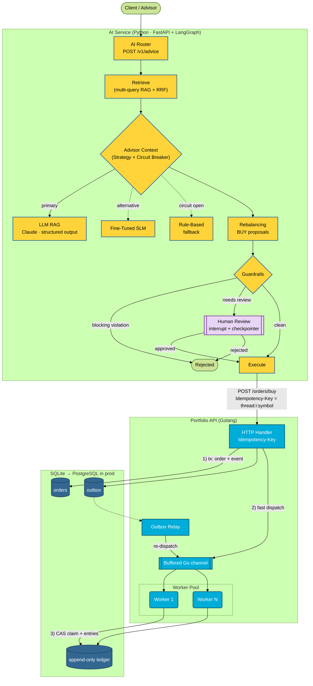

### 1.2 Go backend packages (clean layering)

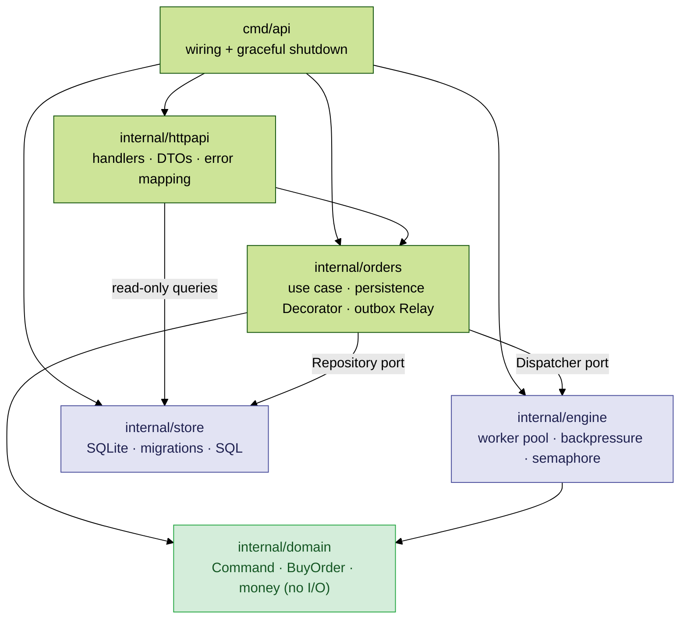

### 1.3 Command pattern (Go)

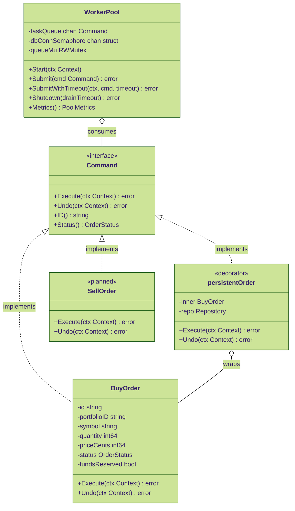

### 1.4 Strategy pattern (Python)

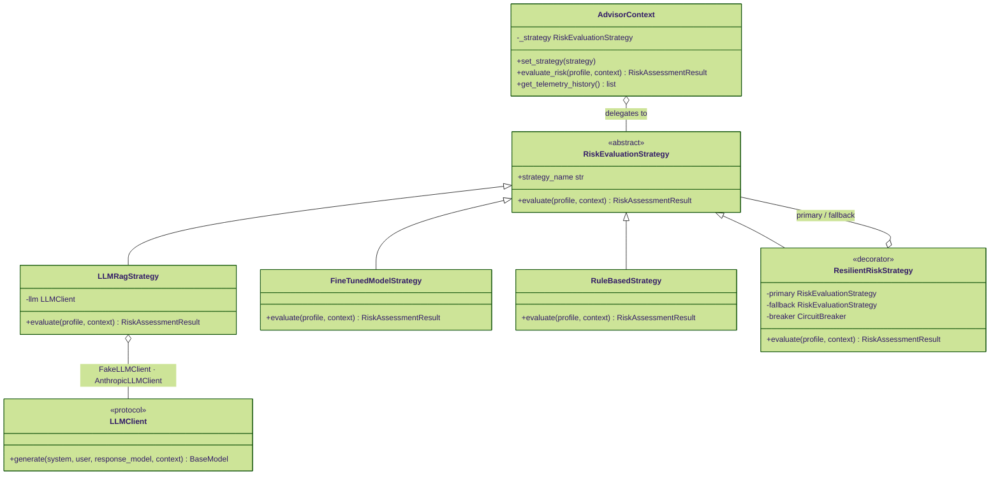

| Component | Status | Location |
|---|---|---|
| FastAPI router, LangGraph graph, guardrails, reviewer auth | ✅ | [`ai-service/src/`](../../ai-service/src/) |
| HTTP handler, worker pool, outbox + relay, append-only ledger, CAS claim | ✅ | [`portfolio-api/internal/`](../../portfolio-api/internal/) |
| `LLMRagStrategy` (Claude, schema-validated) · `RuleBasedStrategy` | ✅ | [`strategy.py`](../../ai-service/src/strategy.py), [`llm.py`](../../ai-service/src/llm.py) |
| `FineTunedModelStrategy` | 🟡 | Real contract, simulated inference |
| `SellOrder` · persistent checkpointer (Postgres/Redis) · API Gateway / ALB | ⬜ | Roadmap |

---

## 2. Infrastructure diagram

Terraform on AWS, split into reusable modules and tested in four layers up to a real `apply` against LocalStack. **Not applied to a real AWS account.** Details, tests and known gaps: [infra/README.md](../../infra/README.md).

### 2.1 Network and services

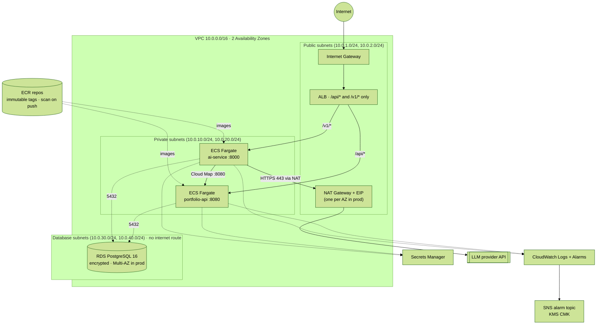

| Security group | Inbound | Outbound |
|---|---|---|
| `alb-sg` | 80 and 443 from the internet | 8080 and 8000 to `ecs-sg` only |
| `ecs-sg` | 8080 and 8000 from `alb-sg`; 8080 from itself (ai-service → portfolio-api) | 5432 to `rds-sg`; 8080 to itself; **443 to the internet** (LLM API, AWS APIs) |
| `rds-sg` | 5432 **only from `ecs-sg`** | none |

### 2.2 Terraform modules

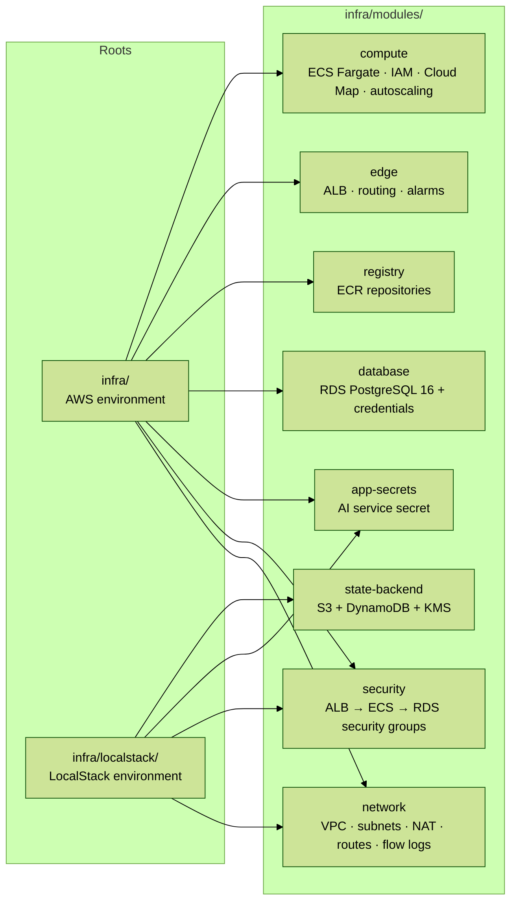

### 2.3 How the infrastructure is tested

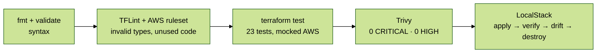

---

## 3. Database diagram

### 3.1 Relational model (portfolio-api)

Schema: [`migrations/001_init.sql`](../../portfolio-api/internal/store/migrations/001_init.sql). SQLite today; PostgreSQL in production (only the `store` package changes).

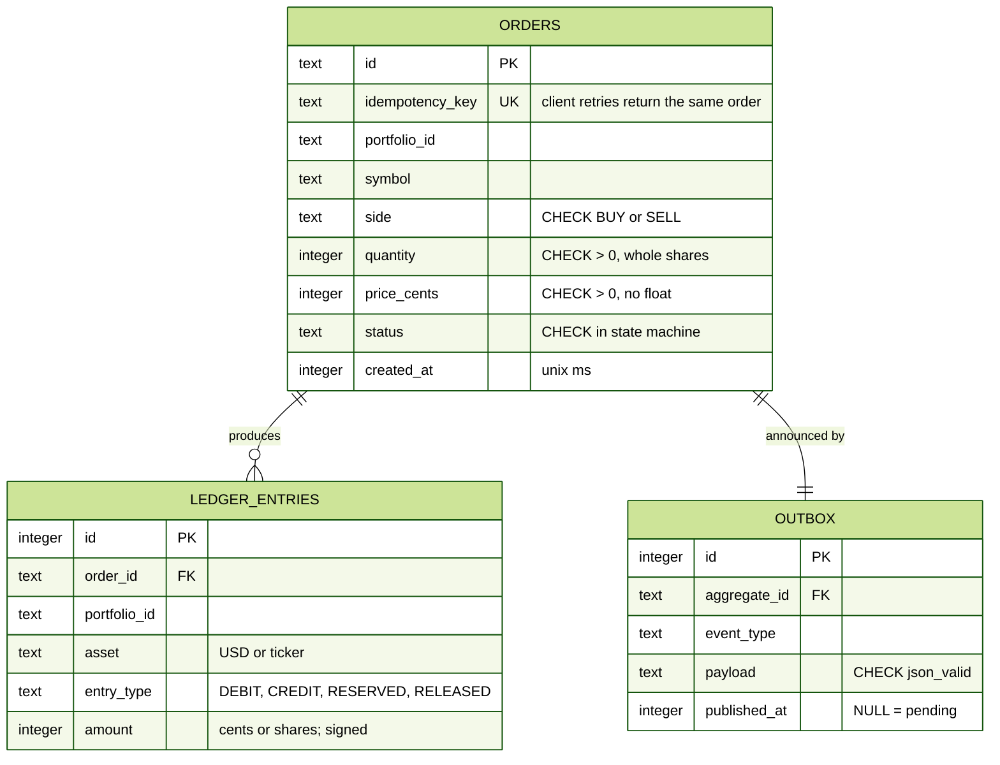

| SQL technique | Where | Why |
|---|---|---|
| `UNIQUE`, `CHECK`, `FOREIGN KEY` | all tables | Invariants enforced by the database, not only by code |
| Triggers that `RAISE(ABORT)` on `UPDATE`/`DELETE` | `ledger_entries` | Append-only audit trail |
| Partial index `WHERE published_at IS NULL` | `outbox` | The relay scans only pending events |
| Compare-and-set `UPDATE … WHERE status='PENDING'` | `ClaimOrder` | At-most-once execution without long locks |
| `SUM(amount) … GROUP BY asset` | positions | Balances derived from the ledger, never stored |

### 3.2 Order lifecycle

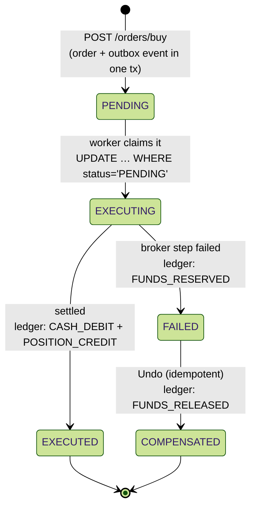

---

## 4. Vector database

### 4.1 Today: in-memory vector index ✅

[`retrieval.py`](../../ai-service/src/retrieval.py) builds the index at startup from the Markdown knowledge base. Vectors are sparse TF-IDF, L2-normalized, so the dot product is cosine similarity. This keeps CI and evals deterministic and needs no infrastructure.

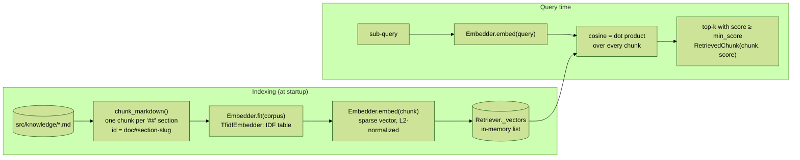

### 4.2 Target: PostgreSQL + pgvector ⬜

The `Embedder` protocol is the swap point: a dense embedder and a pgvector-backed retriever can replace TF-IDF without touching the graph. RDS PostgreSQL 16 is already provisioned in Terraform; the extension would be enabled with `CREATE EXTENSION vector`. The swap should happen only when the golden set shows a recall gain.

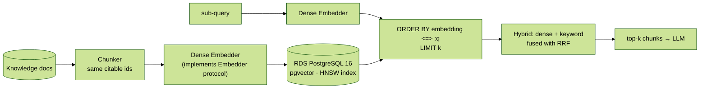

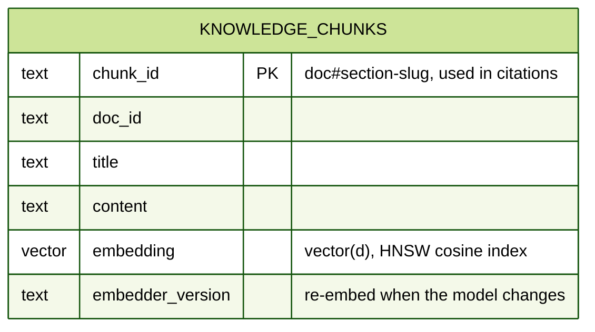

| Item | Status |
|---|---|
| `Embedder` protocol, `TfidfEmbedder`, in-memory `Retriever` with `search` / `search_many` (RRF) | ✅ |
| RDS PostgreSQL 16 in Terraform | ✅ (not applied) |
| Dense embeddings, `knowledge_chunks` table, pgvector HNSW index, hybrid search | ⬜ |

---

## 5. LangChain / LangGraph

The AI service uses **LangGraph** (`StateGraph`, `interrupt`, `Command`, `MemorySaver`) on top of **langchain-core** (`RunnableConfig`). It is a fixed workflow, not an autonomous agent: the LLM decides the content of one step, the code decides the control flow.

### 5.1 Workflow graph

Generated from the compiled graph (`graph.get_graph().draw_mermaid()`). Dotted arrows are conditional edges.

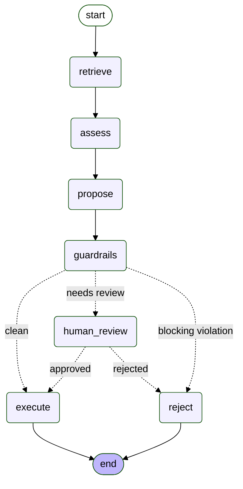

| Node | What it does |
|---|---|
| `retrieve` | One sub-query per concern, fused with Reciprocal Rank Fusion |
| `assess` | Active Strategy: LLM RAG behind a circuit breaker, rule-based fallback |
| `propose` | Target allocation → BUY orders funded only by available cash |
| `guardrails` | Blocking rules and human-review triggers |
| `human_review` | `interrupt()`; the checkpointer persists state until a reviewer responds |
| `execute` | Calls `portfolio-api` with `Idempotency-Key = <thread>:<i>:<symbol>` |
| `reject` | Terminal state; nothing is executed |

### 5.2 Request lifecycle with human approval

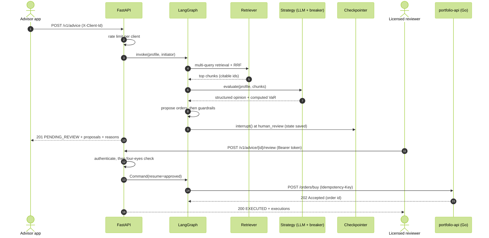

### 5.3 "The LLM explains, the code computes"

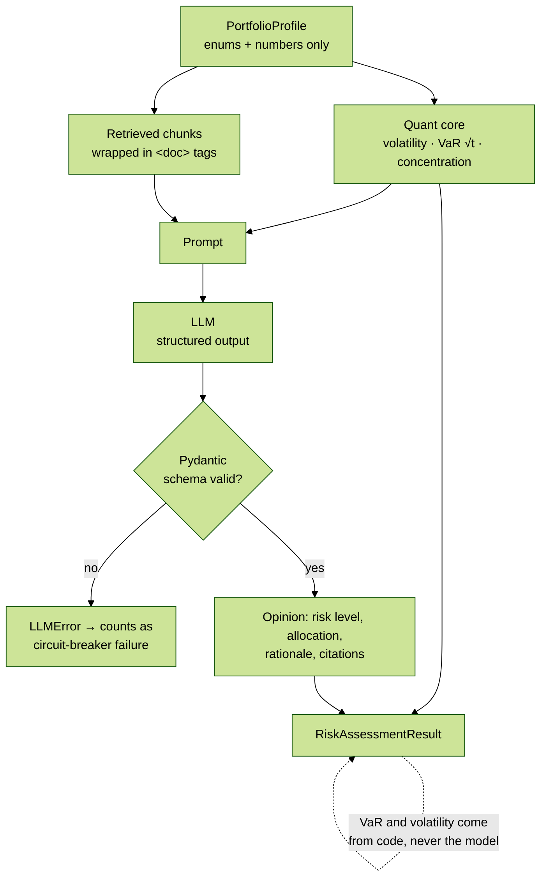

---

## 6. RAG retrieval

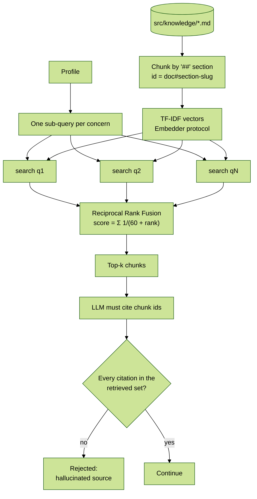

Multi-query + RRF exists because a single concatenated query buried the crypto policy in 7th place; the offline evals caught it.

---

## 7. Guardrails

### 7.1 Block vs. escalate

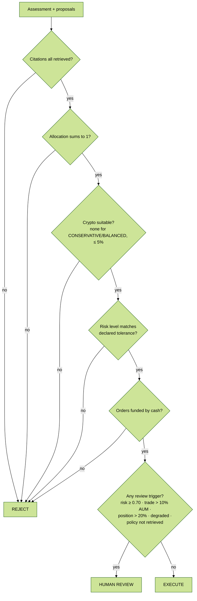

Blocking rules protect against **wrong** answers; review triggers protect against **risky** ones. Code: [`guardrails.py`](../../ai-service/src/guardrails.py).

### 7.2 Trust boundary

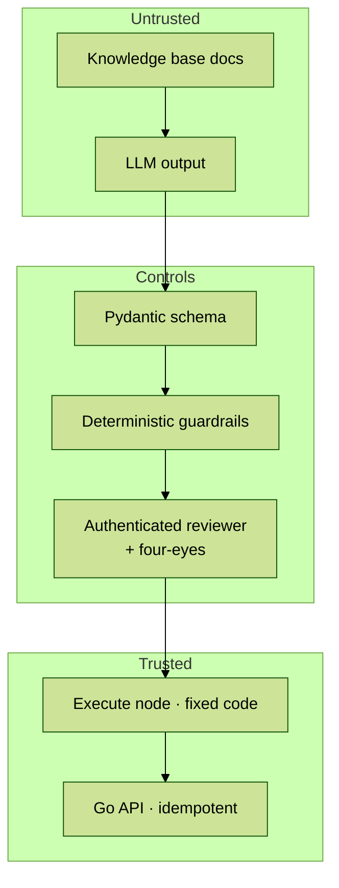

---

## 8. Resilience (circuit breaker)

### 8.1 Request flow

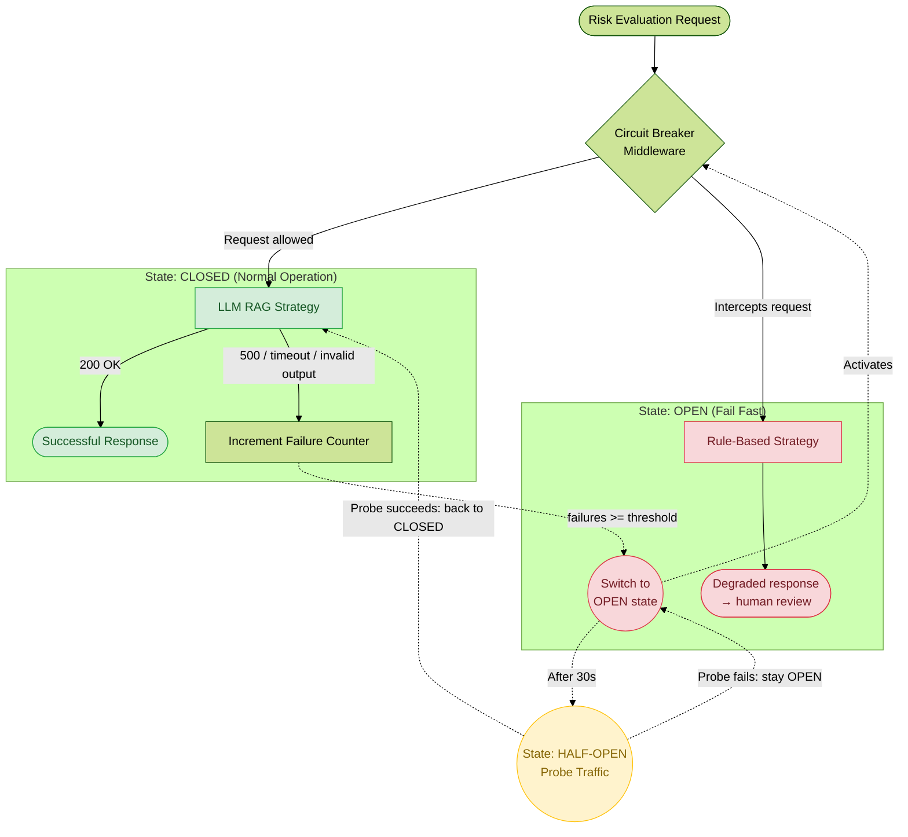

### 8.2 State machine

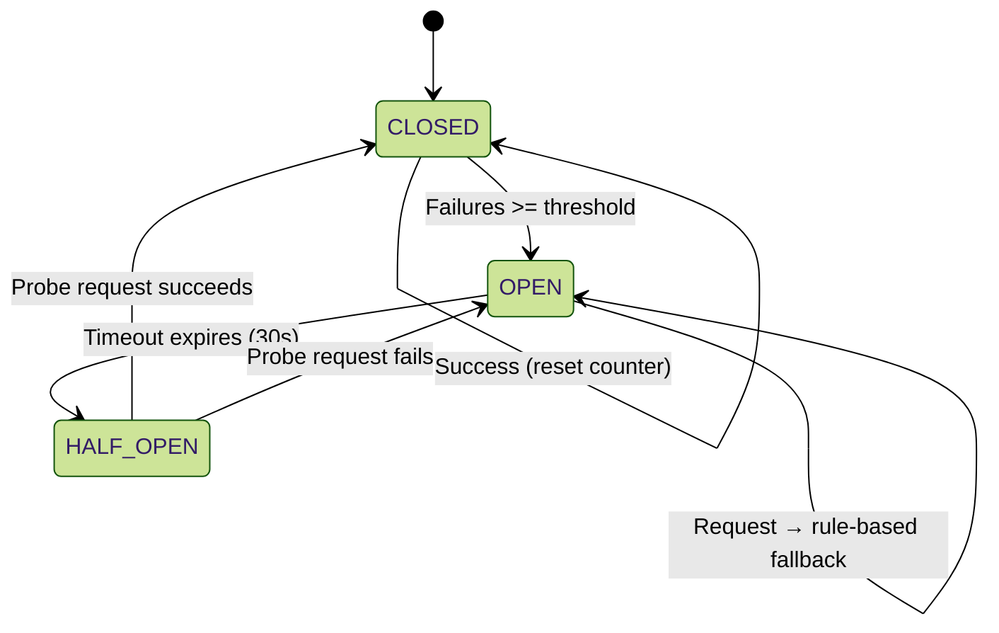

---

## 9. End-to-end flow and CI/CD

### 9.1 End-to-end flow

```mermaid
%%{init: {"theme": "forest"}}%%
sequenceDiagram
    autonumber
    actor A as Advisor app
    participant AI as AI service (FastAPI + LangGraph)
    actor R as Licensed reviewer
    participant GO as portfolio-api (Go)
    participant DB as SQLite / PostgreSQL
    participant W as Worker pool

    A->>AI: POST /v1/advice (portfolio)
    AI->>AI: retrieve policy docs (multi-query RAG)
    AI->>AI: compute risk (quant core) + LLM opinion (structured, cited)
    AI->>AI: propose BUY orders, then guardrails
    alt blocking violation (hallucination, unsuitable, unfunded)
        AI-->>A: REJECTED (nothing executed)
    else needs review (large trade, high risk, degraded)
        AI-->>A: PENDING_REVIEW
        R->>AI: POST /review (bearer token, four-eyes)
        AI->>GO: POST /orders/buy (Idempotency-Key)
    else clean
        AI->>GO: POST /orders/buy (Idempotency-Key)
    end
    GO->>DB: one tx: order PENDING + outbox event
    GO-->>AI: 202 Accepted
    GO->>W: dispatch (a relay re-dispatches if this is lost)
    W->>DB: CAS claim → saga → append-only ledger entries
```

### 9.2 CI/CD pipeline

```mermaid
%%{init: {"theme": "forest"}}%%
flowchart LR
    PUSH([push / PR]) --> S1

    subgraph S1 ["Stage 1 · fast feedback (parallel)"]
        direction TB
        SEC["Secrets scan<br/>gitleaks · full history"]
        GO["Go backend<br/>vet · test -race · coverage · govulncheck"]
        PY["Python AI<br/>ruff · pytest · offline evals · pip-audit"]
        TF["Terraform static<br/>fmt · validate · TFLint · terraform test · Trivy"]
        HD["Dockerfile lint<br/>hadolint"]
    end

    subgraph S2 ["Stage 2 · integration"]
        direction TB
        DS["MLOps dataset<br/>generate · JSONL · quality gate"]
        IMG["Containers ×2<br/>build · /health smoke test · non-root ·<br/>Trivy image gate · SBOM"]
        LS["Infra on LocalStack<br/>apply · verify via AWS API ·<br/>drift check · destroy"]
    end

    PY --> DS
    GO & PY & HD --> IMG
    TF --> LS
    S2 --> SUM(["Pipeline summary<br/>gate table · fail if any gate failed"])
```

Every gate can fail the build: secrets in history, tests and the race detector, vulnerable dependencies the code reaches, evals below threshold, dataset quality, Terraform tests, CRITICAL misconfigurations, fixable CRITICAL CVEs in the images, a container that does not start healthy, and infrastructure that fails to apply, verify or tear down cleanly. Third-party binaries are pinned and SHA-256 verified through one composite action.
