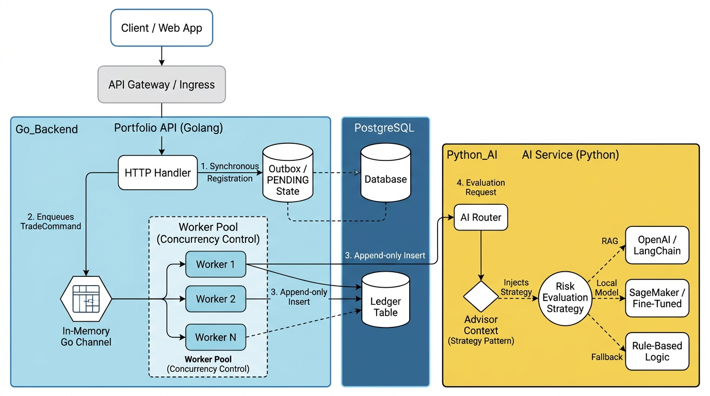

# Full Architecture Diagram

```mermaid
graph TD
    Client([Cliente / Web App]) --> API[API Gateway / Ingress]

    subgraph Go_Backend ["Portfolio API (Golang)"]
        API --> Handler[HTTP Handler]
        
        %% Outbox pattern for durability
        Handler -->|1. Synchronous Record| Outbox[(Outbox / State PENDING)]
        
        %% Command pattern + Worker Pool
        Handler -->|2. Enqueue TradeCommand| Channel[[Go Channel in Memory]]
        
        subgraph Worker_Pool ["Worker Pool (Concurrency Control)"]
            Channel --> W1(Worker 1)
            Channel --> W2(Worker 2)
            Channel --> WN(Worker N)
        end
    end

    subgraph Database ["PostgreSQL"]
        Outbox
        %% Write‑lock prevention
        W1 -->|3. Append‑only Insert| Ledger[(Ledger Table)]
        W2 -->|3. Append‑only Insert| Ledger
        WN -.-> Ledger
    end

    subgraph Python_AI ["AI Service (Python)"]
        W1 -->|4. Evaluation Request| AI_API[Router IA]
        AI_API --> Context{Advisor Context\n(Strategy Pattern)}
        
        Context -->|Inject Strategy| Strategy((Risk Evaluation\nStrategy))
        
        Strategy -.->|RAG| S_OpenAI[OpenAI / LangChain]
        Strategy -.->|Local Model| S_SageMaker[SageMaker / Fine‑Tuned]
        Strategy -.->|Fallback| S_Rule[Rule‑Based Logic]
    end

    %% Styles
    classDef go fill:#00ADD8,stroke:#005d73,stroke-width:2px,color:white;
    classDef python fill:#FFD43B,stroke:#306998,stroke-width:2px,color:black;
    classDef db fill:#336791,stroke:#234a68,stroke-width:2px,color:white;
    
    class Go_Backend,Handler,Channel,W1,W2,WN go;
    class Python_AI,AI_API,Context,Strategy,S_OpenAI,S_SageMaker,S_Rule python;
    class Database,Outbox,Ledger db;
```


