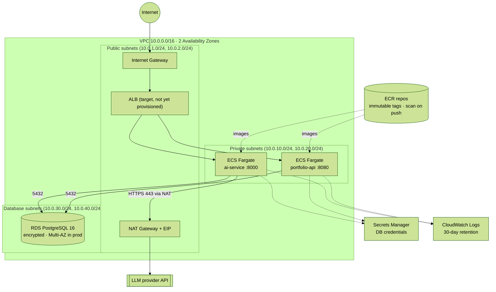

# Infrastructure (`infra`) — Terraform on AWS

Infrastructure as code for the target AWS environment. It is validated and security-scanned in CI (`terraform fmt`, `terraform validate`, Trivy with a blocking gate on CRITICAL findings). **It has not been applied to a real account.**

## 1. Network and service topology



## 2. Security groups (least privilege)

| Security group | Inbound | Outbound |
|---|---|---|
| `ecs-sg` (services) | 8080 and 8000 from the VPC CIDR only | **5432 to the database subnets**; **443 to the internet via NAT** (LLM API, AWS APIs) |
| `rds-sg` (database) | 5432 **only from `ecs-sg`** | VPC CIDR only |

### Accepted risk (documented in code)
Trivy rule **AWS-0104** flags any egress to `0.0.0.0/0`. The AI service needs outbound HTTPS to the LLM provider, so egress is limited to **TCP 443** and the rule is suppressed inline with `#trivy:ignore:AVD-AWS-0104` and a written justification. Mitigation path: VPC endpoints for AWS services, plus an egress proxy with a domain allowlist for the LLM provider.

### Fixed findings
- **AWS-0104 (CRITICAL):** unrestricted egress on all protocols was replaced by the two scoped rules above.
- **AWS-0164 (HIGH):** public subnets no longer auto-assign public IPs. The ALB and NAT use explicit addresses.

## 3. Data protection

| Control | Setting |
|---|---|
| Encryption at rest | RDS `storage_encrypted = true`, ECR AES-256 |
| Credentials | Random 32-char password stored in Secrets Manager, never in code or variables |
| Backups | 14-day retention; final snapshot and deletion protection in `prod` |
| Availability | Multi-AZ RDS in `prod`; subnets spread across 2 AZs |
| Supply chain | ECR immutable tags + image scan on push |
| Observability | Container Insights + CloudWatch log groups per service |

## 4. Known gaps (honest status)

| Gap | Why it matters | Next step |
|---|---|---|
| No ALB, ECS services or task definitions | Nothing is actually deployable yet | Add an ALB + ECS services that pull images from ECR |
| Single NAT gateway | One AZ failure cuts outbound traffic | One NAT per AZ in `prod` |
| `recovery_window_in_days = 0` on the secret | Immediate deletion, no recovery | 7–30 days in `prod` |
| No remote state backend | Local state cannot be shared or locked | S3 backend + DynamoDB lock table |
| `pgcrypto` listed in `shared_preload_libraries` | Not a preloadable library on RDS; `apply` would likely fail | Remove it and use `CREATE EXTENSION` instead |

## Validate locally

```bash
cd infra
terraform fmt -check
terraform init -backend=false
terraform validate
```
