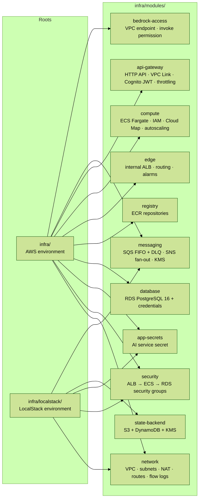
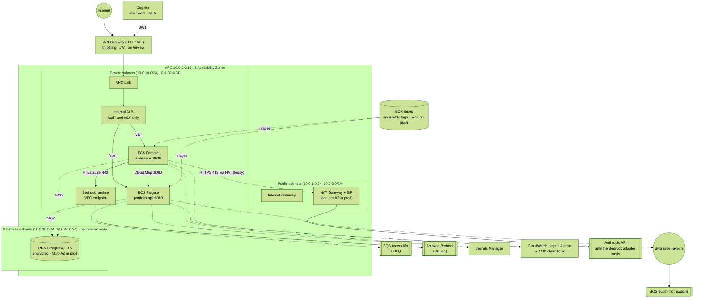
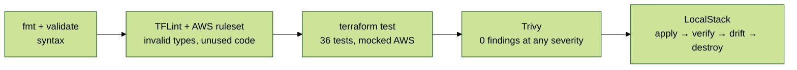

# Infrastructure (`infra`) — Terraform on AWS, tested with LocalStack

Infrastructure as code for the AWS environment, split into reusable modules. Every change goes through four layers of checks in CI, from static analysis to a real `apply` against LocalStack. **It has not been applied to a real AWS account.**

Design decisions: [ADR 005](../docs/adr/005-aws-managed-services-edge-messaging-bedrock.md) (API Gateway, SQS/SNS, Bedrock) · [ADR 003](../docs/adr/003-persistence-outbox-sqlite.md) (persistence)

## 1. Module structure

The root module (`infra/`) composes the AWS environment. `infra/localstack/` applies the **same modules** against LocalStack, so the network, security and messaging layers are created for real in CI.



| Module | Creates | Tested by |
|---|---|---|
| `network` | VPC, public/private/database subnets in 2 AZs, IGW, NAT (one or one per AZ), route tables, VPC flow logs | `terraform test` + LocalStack |
| `security` | ALB, ECS and RDS security groups with chained least-privilege rules; internet ingress on the ALB only when it is public | `terraform test` + LocalStack |
| `app-secrets` | AI service secret (value set out-of-band, never in state) | LocalStack |
| `state-backend` | Versioned, KMS-encrypted, TLS-only S3 bucket + DynamoDB lock table | LocalStack |
| `messaging` | SQS FIFO order queue with DLQ, SNS order-event topic fanned out to audit and notifications queues (each with a DLQ), DLQ alarms, one customer-managed KMS key | `terraform test` + LocalStack (behavior included) |
| `database` | RDS PostgreSQL 16, parameter group, subnet group, credentials secret | `terraform test` |
| `registry` | ECR repositories (immutable tags, scan on push, lifecycle) | `terraform test` (root) |
| `edge` | ALB (internal behind API Gateway), HTTP/HTTPS listeners, path routing, 5xx and unhealthy-host alarms | `terraform test` |
| `compute` | ECS cluster, IAM roles, Cloud Map, task definitions, services, CPU autoscaling | `terraform test` |
| `api-gateway` | HTTP API, VPC Link to the internal ALB, Cognito user pool for reviewers (MFA, no self sign-up), JWT authorizer on the review route, stage throttling, JSON access logs | `terraform test` |
| `bedrock-access` | Interface VPC endpoint for `bedrock-runtime`, invoke permission limited to Anthropic models | `terraform test` |

LocalStack's free edition does not emulate ECS, ALB, RDS, ECR, API Gateway v2 or Cognito, so those modules are covered by `terraform test` with a mocked provider instead.

## 2. Network and service topology



API Gateway is the **only public entry point**: the ALB is internal and accepts traffic only from the VPC Link. Dotted arrows to SQS, SNS and Bedrock are provisioned and permitted, but the application does not use them yet (see the status table in [ADR 005](../docs/adr/005-aws-managed-services-edge-messaging-bedrock.md)).

## 3. Security groups (least privilege)

| Security group | Inbound | Outbound |
|---|---|---|
| `apigw-vpclink-sg` | — (API Gateway's managed side) | The ALB listener port to `alb-sg` only |
| `alb-sg` | The listener port **only from `apigw-vpclink-sg`** (no internet ingress) | 8080 and 8000 to `ecs-sg` only |
| `ecs-sg` | 8080 and 8000 from `alb-sg`; 8080 from itself (ai-service → portfolio-api) | 5432 to `rds-sg`; 8080 to itself; 443 to `bedrock-endpoint-sg`; **443 to the internet** (Anthropic API until Bedrock is wired, AWS APIs) |
| `bedrock-endpoint-sg` | 443 only from `ecs-sg` | none |
| `rds-sg` | 5432 **only from `ecs-sg`** | none |

**Accepted risk (documented in code).** Trivy rule AWS-0104 flags egress to `0.0.0.0/0`. Today the AI service needs outbound HTTPS to the Anthropic API, so egress is limited to TCP 443 and suppressed inline with a justification. With the Bedrock adapter, model traffic moves to the private endpoint; interface endpoints for ECR, Secrets Manager and CloudWatch Logs would then allow removing internet egress entirely.

**Removed risks.** With API Gateway in front, the ALB no longer accepts traffic from the internet, so the public-ingress findings (AWS-0053, AWS-0107) no longer apply to the AWS environment.

## 4. How the infrastructure is tested



| Layer | What it catches | Time |
|---|---|---|
| `terraform fmt` / `validate` | Syntax and type errors | seconds |
| **TFLint** (AWS ruleset) | Invalid instance types, missing `required_version`, unused providers | seconds |
| **`terraform test`** with `mock_provider` | Wrong behavior: prod without one NAT per AZ, a database reachable from the ALB, the review route without a JWT, an internet-facing ALB behind API Gateway, Bedrock access beyond Anthropic models, a queue without its DLQ, bad inputs accepted | ~15 s |
| **Trivy** | Security misconfigurations (CRITICAL blocks the build) | seconds |
| **LocalStack** | Real API calls and dependency ordering, verified independently through boto3, real queue and topic behavior, plus an **idempotency check**: a second `plan` after `apply` must be empty | ~3 min |

The tests were checked against deliberate bugs: pointing the database rule at the ALB security group makes `least_privilege_chain` fail, and removing the JWT from the review route makes `review_route_requires_a_cognito_jwt` fail.

`localstack/smoke_test.py` reads every resource back through the AWS API instead of trusting Terraform's own report, and exercises the messaging for real:

| Check | Property |
|---|---|
| VPC and subnets | 6 subnets across 2 AZs, no automatic public IPs |
| NAT | One NAT gateway per AZ, inside public subnets |
| Routing | public → IGW, private → NAT, database → no internet route |
| Database isolation | Exactly one ingress rule: 5432 from `ecs-sg` |
| Egress | The only internet egress is TCP 443 |
| Flow logs | Capture all traffic |
| State bucket | Versioned, all public access blocked, KMS-encrypted, non-TLS requests denied |
| Lock table | `LockID` hash key, on-demand billing |
| Order queue | FIFO, KMS-encrypted, redrives to its DLQ after 5 receives |
| **FIFO deduplication** | The same order sent twice with one idempotency key is delivered once |
| **Dead-letter redrive** | A message received 6 times without being deleted ends up in the DLQ |
| **Event fan-out** | One event published to SNS reaches the audit and notifications queues as a raw message |
| Drift | A second plan is empty. Tolerated narrowly: two documented emulator quirks and JSON that differs only in whitespace; values "known after apply" only when every known change is cosmetic |

## 5. Data protection

| Control | Setting |
|---|---|
| Encryption at rest | RDS `storage_encrypted`, ECR AES-256; Terraform state, alarm topic, queues and order-event topic with customer-managed KMS keys (rotation on) |
| Credentials | Random 32-char password in Secrets Manager; the AI service secret value is set out-of-band, never in code or state; Bedrock access by IAM role, no API key |
| Identity | Reviewers in Cognito with MFA, no self sign-up, admin-only recovery; JWT validated at API Gateway |
| Edge | Managed throttling on the API stage; JSON access logs; internal ALB |
| Backups | 7–35 days enforced by validation (14 by default); final snapshot and deletion protection in `prod` |
| Availability | Multi-AZ RDS and one NAT per AZ in `prod`; ECS services spread across 2 AZs with autoscaling |
| Failed work | Every queue has a DLQ (14-day retention) with an alarm |
| Deployments | ECS deployment circuit breaker with automatic rollback |
| Supply chain | ECR immutable tags + scan on push; CI images scanned by Trivy with an SBOM per image |
| Observability | Container Insights, per-service log groups, API access logs, VPC flow logs, alarms → SNS (optional email) |

## 6. Run it locally

```bash
cd infra

# Static checks and tests (no AWS account, no Docker)
terraform fmt -check -recursive
terraform init -backend=false && terraform validate
tflint --init && tflint --recursive
terraform test

# Real apply against LocalStack (needs Docker)
docker compose -f localstack/docker-compose.yml up -d --wait
./localstack/run.sh                 # apply → verify → drift check → destroy
docker compose -f localstack/docker-compose.yml down
```

Without Docker, the same script runs against moto, the AWS emulator LocalStack's EC2 support is built on:

```bash
uvx --from "moto[server]" moto_server -H 127.0.0.1 -p 4566 &   # loopback only
./localstack/run.sh
```

LocalStack is pinned to `4.14.0`, the last community release that runs without an account. Newer (CalVer) images need `LOCALSTACK_AUTH_TOKEN`.

## 7. Bootstrap the state backend (real AWS)

The state backend cannot store its own state, so it is created once with local state:

```hcl
# bootstrap/main.tf (not committed)
module "state_backend" {
  source      = "../modules/state-backend"
  name        = "fin-ai-advisor"
  bucket_name = "fin-ai-advisor-tfstate-<account-id>"
}
```

Then copy `backend.hcl.example` to `backend.hcl` and run `terraform init -backend-config=backend.hcl`.

## 8. Known gaps (honest status)

| Gap | Why it matters | Next step |
|---|---|---|
| Never applied to a real AWS account | Real IAM, quotas and service limits are untested | Apply to a sandbox account from a CD job with OIDC (no long-lived keys) |
| SQS, SNS and Bedrock are provisioned but not used by the application | The in-process channel, log-only compensation failures and the Anthropic API call remain | Outbox relay produces to SQS; publish order events to SNS; `BedrockLLMClient` adapter ([ADR 005](../docs/adr/005-aws-managed-services-edge-messaging-bedrock.md)) |
| Reviewer identity still comes from in-memory tokens | The Cognito authorizer is in place, but the service does not read the JWT claims yet | Take the reviewer from the validated JWT; drop the token map |
| portfolio-api uses SQLite on ephemeral task storage | Data is lost when a task stops; RDS is provisioned but unused | PostgreSQL adapter in `internal/store` (only that package changes) |
| ECS, ALB, RDS, ECR, API Gateway and Cognito are not applied in LocalStack | Free LocalStack does not emulate them | Covered by mocked `terraform test`; LocalStack Pro would allow a full apply |
| No WAF in front of API Gateway | No managed rules against common web attacks | AWS WAF with managed rule groups on the API stage |
| Only the Bedrock endpoint exists | Other AWS API traffic still goes through the NAT | Interface endpoints for ECR, Secrets Manager, Logs; gateway endpoint for S3; then remove internet egress |
| The DLQ only accepts redrives by configuration | Any queue in the account with `sqs:SendMessage` could target it | Add an SQS redrive-allow policy (omitted because the emulator never reports it back, which hangs the provider) |
| No deploy (CD) stage | Images are built and scanned but not pushed or deployed | Push to ECR and `terraform apply` with `image_tag = <git sha>` after approval |
