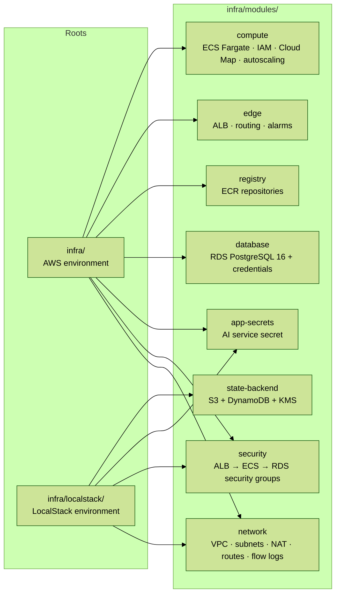
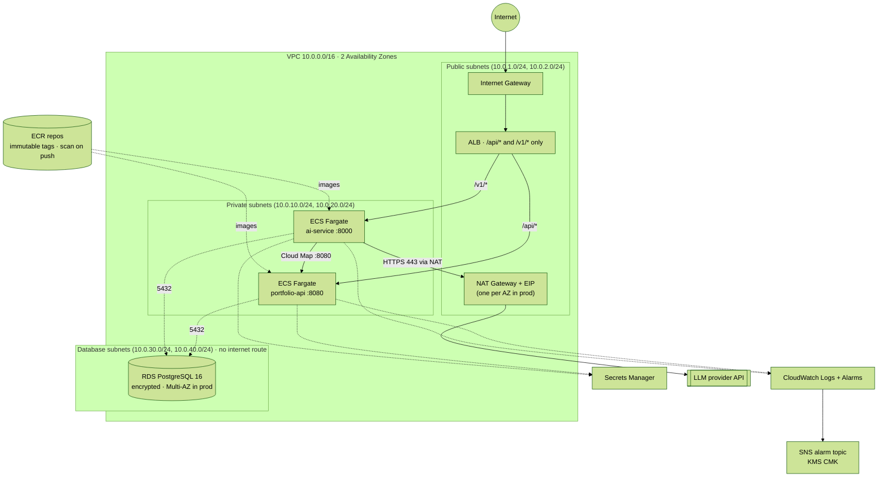
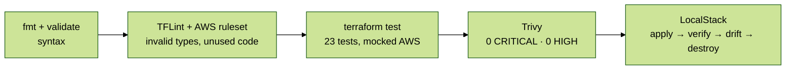

# Infrastructure (`infra`) — Terraform on AWS, tested with LocalStack

Infrastructure as code for the AWS environment, split into reusable modules. Every change goes through four layers of checks in CI, from static analysis to a real `apply` against LocalStack. **It has not been applied to a real AWS account.**

## 1. Module structure

The root module (`infra/`) composes the AWS environment. `infra/localstack/` applies the **same modules** against LocalStack, so the network and security layers are created for real in CI.



| Module | Creates | Tested by |
|---|---|---|
| `network` | VPC, public/private/database subnets in 2 AZs, IGW, NAT (one or one per AZ), route tables, VPC flow logs | `terraform test` + LocalStack |
| `security` | ALB, ECS and RDS security groups with chained least-privilege rules | `terraform test` + LocalStack |
| `app-secrets` | AI service secret (value set out-of-band, never in state) | LocalStack |
| `state-backend` | Versioned, KMS-encrypted, TLS-only S3 bucket + DynamoDB lock table | LocalStack |
| `database` | RDS PostgreSQL 16, parameter group, subnet group, credentials secret | `terraform test` |
| `registry` | ECR repositories (immutable tags, scan on push, lifecycle) | `terraform test` (root) |
| `edge` | ALB, HTTP/HTTPS listeners, path routing, 5xx and unhealthy-host alarms | `terraform test` |
| `compute` | ECS cluster, IAM roles, Cloud Map, task definitions, services, CPU autoscaling | `terraform test` |

LocalStack's free edition does not emulate ECS, ALB, RDS or ECR, so those modules are covered by `terraform test` with a mocked provider instead.

## 2. Network and service topology



## 3. Security groups (least privilege)

| Security group | Inbound | Outbound |
|---|---|---|
| `alb-sg` | 80 and 443 from the internet | 8080 and 8000 to `ecs-sg` only |
| `ecs-sg` | 8080 and 8000 from `alb-sg`; 8080 from itself (ai-service → portfolio-api) | 5432 to `rds-sg`; 8080 to itself; **443 to the internet** (LLM API, AWS APIs) |
| `rds-sg` | 5432 **only from `ecs-sg`** | none |

**Accepted risk (documented in code).** Trivy rule AWS-0104 flags egress to `0.0.0.0/0`. The AI service needs outbound HTTPS to the LLM provider, so egress is limited to TCP 443 and the rule is suppressed inline with a justification. Mitigation path: VPC endpoints for AWS services and an egress proxy with a domain allowlist.

## 4. How the infrastructure is tested



| Layer | What it catches | Time |
|---|---|---|
| `terraform fmt` / `validate` | Syntax and type errors | seconds |
| **TFLint** (AWS ruleset) | Invalid instance types, missing `required_version`, unused providers | seconds |
| **`terraform test`** with `mock_provider` | Wrong behavior: prod without one NAT per AZ, a database reachable from the ALB, HTTPS rules on the wrong listener, an API key injected when the fake LLM is used, bad inputs accepted | ~10 s |
| **Trivy** | Security misconfigurations (CRITICAL blocks the build) | seconds |
| **LocalStack** | Real API calls and dependency ordering, verified independently through boto3, plus an **idempotency check**: a second `plan` after `apply` must be empty | ~2 min |

The tests were checked against deliberate bugs: pointing the database rule at the ALB security group makes `least_privilege_chain` fail with *"The database must only accept traffic from the ECS security group."*

`localstack/smoke_test.py` reads every resource back through the AWS API instead of trusting Terraform's own report:

| Check | Property |
|---|---|
| VPC and subnets | 6 subnets across 2 AZs, no automatic public IPs |
| NAT | One NAT gateway per AZ, inside public subnets |
| Routing | public → IGW, private → NAT, database → no internet route |
| Database isolation | Exactly one ingress rule: 5432 from `ecs-sg` |
| Egress | The only internet egress is TCP 443 |
| Flow logs | Capture all traffic |
| State bucket | Versioned, all public access blocked, KMS-encrypted, non-TLS requests denied |
| Lock table | `LockID` hash key, on-demand billing |
| Drift | A second plan is empty (two documented emulator quirks are tolerated narrowly) |

## 5. Data protection

| Control | Setting |
|---|---|
| Encryption at rest | RDS `storage_encrypted`, ECR AES-256, Terraform state and alarm topic with customer-managed KMS keys (rotation on) |
| Credentials | Random 32-char password in Secrets Manager; the AI service secret value is set out-of-band, never in code or state |
| Backups | 7–35 days enforced by validation (14 by default); final snapshot and deletion protection in `prod` |
| Availability | Multi-AZ RDS and one NAT per AZ in `prod`; ECS services spread across 2 AZs with autoscaling |
| Deployments | ECS deployment circuit breaker with automatic rollback |
| Supply chain | ECR immutable tags + scan on push; CI images scanned by Trivy with an SBOM per image |
| Observability | Container Insights, per-service log groups, VPC flow logs, alarms → SNS (optional email) |

## 6. Run it locally

```bash
cd infra

# Static checks and tests (no AWS account, no Docker)
terraform fmt -check -recursive
terraform init -backend=false && terraform validate
tflint --init && tflint --recursive
terraform test

# Real apply against LocalStack (needs Docker)
docker compose -f localstack/docker-compose.yml up -d --wait
./localstack/run.sh                 # apply → verify → drift check → destroy
docker compose -f localstack/docker-compose.yml down
```

Without Docker, the same script runs against moto, the AWS emulator LocalStack's EC2 support is built on:

```bash
uvx --from "moto[server]" moto_server -H 127.0.0.1 -p 4566 &   # loopback only
./localstack/run.sh
```

LocalStack is pinned to `4.14.0`, the last community release that runs without an account. Newer (CalVer) images need `LOCALSTACK_AUTH_TOKEN`.

## 7. Bootstrap the state backend (real AWS)

The state backend cannot store its own state, so it is created once with local state:

```hcl
# bootstrap/main.tf (not committed)
module "state_backend" {
  source      = "../modules/state-backend"
  name        = "fin-ai-advisor"
  bucket_name = "fin-ai-advisor-tfstate-<account-id>"
}
```

Then copy `backend.hcl.example` to `backend.hcl` and run `terraform init -backend-config=backend.hcl`.

## 8. Known gaps (honest status)

| Gap | Why it matters | Next step |
|---|---|---|
| Never applied to a real AWS account | Real IAM, quotas and service limits are untested | Apply to a sandbox account from a CD job with OIDC (no long-lived keys) |
| portfolio-api uses SQLite on ephemeral task storage | Data is lost when a task stops; RDS is provisioned but unused | PostgreSQL adapter in `internal/store` (only that package changes) |
| ECS, ALB, RDS and ECR are not applied in LocalStack | Free LocalStack does not emulate them | Covered by mocked `terraform test`; LocalStack Pro would allow a full apply |
| No WAF in front of the ALB | No rate limiting or managed rules at the edge | AWS WAF with managed rule groups |
| No VPC endpoints | AWS API traffic goes through the NAT (cost, broader egress) | Interface endpoints for ECR, Secrets Manager, Logs; gateway endpoint for S3 |
| No deploy (CD) stage | Images are built and scanned but not pushed or deployed | Push to ECR and `terraform apply` with `image_tag = <git sha>` after approval |
