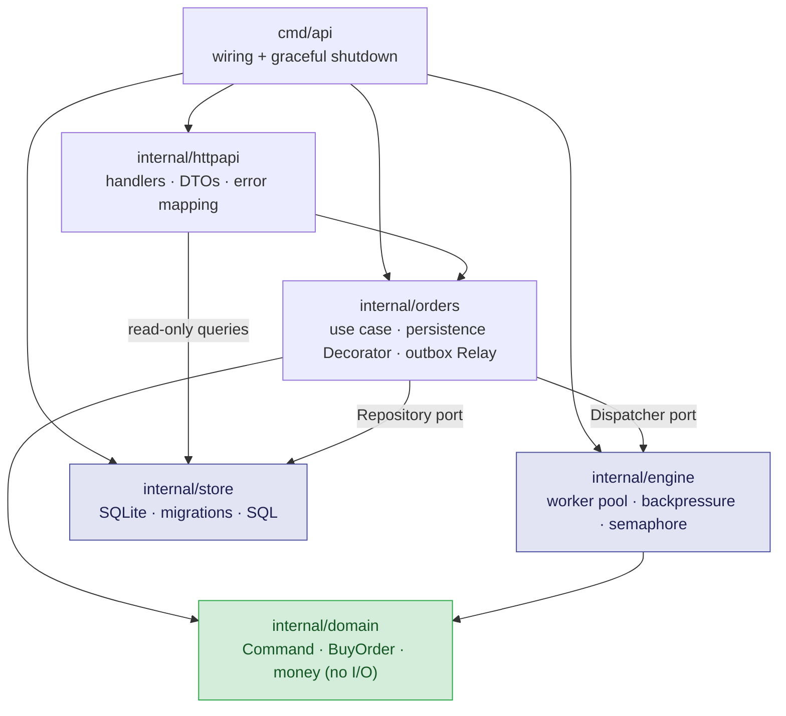
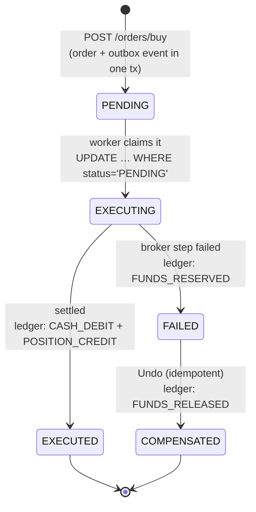
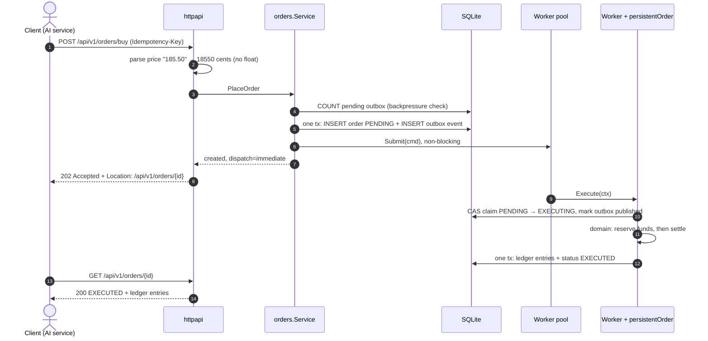
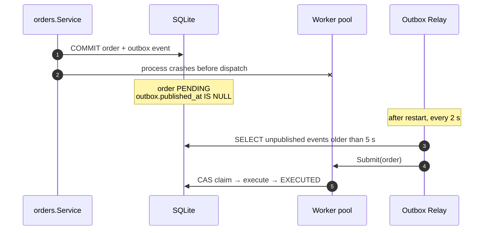
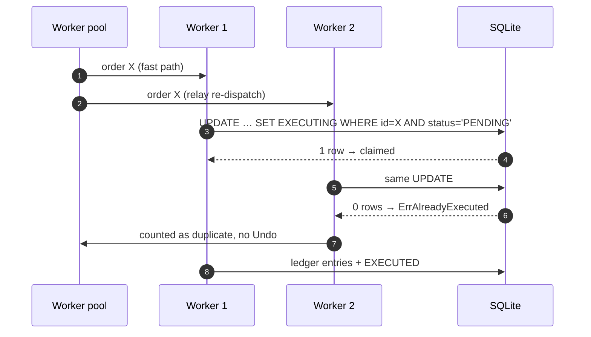
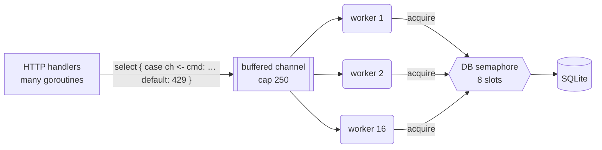
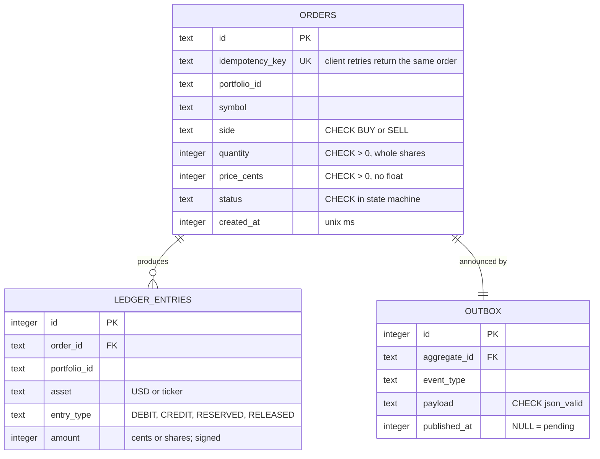

# Portfolio API (`portfolio-api`)

The transactional core. It accepts buy orders over HTTP, persists them **durably and idempotently**, executes them concurrently through a bounded worker pool, and records every movement in an **append-only ledger**.

> Design rationale: [ADR 001](../docs/adr/001-command-worker-pool-go.md) (Command + worker pool) · [ADR 003](../docs/adr/003-persistence-outbox-sqlite.md) (outbox, ledger, idempotency, SQLite)

---

## 1. Package structure (clean layering)



- **`domain`** has no I/O: business rules and the saga state machine only. It is the easiest layer to test and the hardest to break.
- **`orders`** depends on **ports** (`Repository`, `Dispatcher` interfaces), not on SQLite or the pool directly. Swapping SQLite for PostgreSQL only touches `store`.
- **`httpapi`** translates HTTP ↔ use cases and maps domain errors to status codes in one place.

---

## 2. Order lifecycle (state machine)



`EXECUTING` exists only in the database. It is the **claim** that makes duplicate deliveries harmless: only one worker can move an order out of `PENDING`.

---

## 3. Happy path



---

## 4. Failure scenarios (why the design holds)

### 4.1 The process crashes after the 202



Durability comes from the **single local transaction** that writes the order and its event together. Publishing to a broker directly from the handler would create a *dual write* (the DB commits and the broker fails, or the reverse).

### 4.2 The same order is delivered twice



**At-least-once delivery + idempotent consumer = effectively-once execution.** The test `TestRelay_DuplicateDeliveryExecutesOnce` proves it.

### 4.3 The client retries after a timeout

The `UNIQUE(idempotency_key)` constraint means the retry returns **200 with the original order**, not a second order. Test: `TestPlaceOrder_IdempotentRetryDoesNotDuplicate`.

### 4.4 The broker step fails (saga compensation)

`Execute` reserves funds, then settles. If settlement fails, the worker calls `Undo`, which releases the reservation with a **reversing ledger entry**. The net effect on the portfolio is zero, and the history is fully auditable. `Undo` is idempotent and refuses to "compensate" an order that never reserved anything.

---

## 5. Concurrency model



| Mechanism | Problem it solves |
|---|---|
| Fixed pool of 16 workers | Unbounded goroutines exhausting memory and DB connections |
| Non-blocking `select/default` submit | Slow consumers blocking HTTP handlers. A full queue returns 429 instead. |
| Semaphore (8) < workers (16) | More concurrent transactions than the database can handle |
| `RWMutex` around the channel close + `quit` channel | Panic from *send on closed channel* when submit races with shutdown (a real bug, now covered by a regression test) |
| Pool context independent of the OS signal context | SIGTERM aborting queued orders. Shutdown now **drains** them. |
| Atomic counters | Lock-free metrics read by `GET /api/v1/metrics` |

**Ordered shutdown:** stop accepting HTTP → stop the relay → drain the pool → close the database.

---

## 6. Data model



| SQL technique | Where | Why |
|---|---|---|
| `UNIQUE`, `CHECK`, `FOREIGN KEY` | `orders`, `outbox`, `ledger_entries` | Invariants enforced by the database, not only by code |
| Triggers that `RAISE(ABORT)` on `UPDATE`/`DELETE` | `ledger_entries` | Append-only audit trail |
| Partial index `WHERE published_at IS NULL` | `outbox` | The relay scans only pending events, not history |
| Composite index `(portfolio_id, created_at DESC)` | `orders` | Order history per portfolio |
| `SUM(amount) … GROUP BY asset HAVING total <> 0` | `Positions` | Balances derived from the ledger, never stored |
| Compare-and-set `UPDATE … WHERE status='PENDING'` | `ClaimOrder` | Optimistic concurrency without locks held across work |
| WAL + `busy_timeout` + `_txlock=immediate` | DSN | Concurrent readers, one writer, no lock-upgrade deadlocks |
| Embedded, versioned migrations | `store.migrate` | Schema changes tracked in `schema_migrations` |

---

## 7. HTTP API

| Method & path | Success | Errors |
|---|---|---|
| `POST /api/v1/orders/buy` | `202` new order (`Location` header) · `200` idempotent replay | `400` invalid JSON / unknown field / bad price / invalid order · `429` backlog exceeded (`Retry-After`) |
| `GET /api/v1/orders/{id}` | `200` order + ledger entries | `404` |
| `GET /api/v1/portfolios/{id}/positions` | `200` positions derived from the ledger | — |
| `GET /api/v1/metrics` | `200` pool counters (submitted, executed, failed, compensated, rejected, duplicates) | — |
| `GET /health` | `200` UP (checks the database) | `503` DOWN |

Request body for a buy order (the price is a **string** on purpose):

```json
{ "portfolio_id": "port-demo", "symbol": "NVDA", "quantity": 5, "price": "120.25" }
```

---

## 8. Testing strategy

| Level | Examples | Technique |
|---|---|---|
| Unit (domain) | saga compensation, idempotent `Undo`, double `Execute` rejected, money parsing | Pure functions, table-driven tests |
| Concurrency | submit during shutdown (100 rounds × 16 goroutines), drain on shutdown, backpressure | `go test -race` in CI |
| Integration (SQL) | idempotent create, 20 concurrent claims → exactly 1 winner, triggers reject UPDATE/DELETE, positions net to zero | Real SQLite in a temp dir per test |
| Integration (use case) | crash recovery via the relay, duplicate delivery executes once, backpressure | Real store + real pool |
| HTTP contract | 202 → 200 replay, 400 cases, 404, positions JSON | `httptest` server |

---

## Run it

```bash
cd portfolio-api
go test ./...                 # all tests (CI also runs -race)
go run ./cmd/api              # listens on 127.0.0.1:8080 (HOST=0.0.0.0 only inside containers)

# Optional demo traffic: 25 concurrent orders, one forced failure to show compensation
SIMULATE_LOAD=true go run ./cmd/api
```

| Env var | Default | Purpose |
|---|---|---|
| `HOST` | `127.0.0.1` | Bind address (secure default: loopback only) |
| `PORT` | `8080` | HTTP port |
| `DB_PATH` | `data/portfolio.db` | SQLite file (git-ignored) |
| `SIMULATE_LOAD` | unset | `true` fires a demo burst through the HTTP API |

```bash
curl -i -X POST 127.0.0.1:8080/api/v1/orders/buy \
  -H 'Content-Type: application/json' -H 'Idempotency-Key: demo-1' \
  -d '{"portfolio_id":"port-demo","symbol":"NVDA","quantity":5,"price":"120.25"}'
curl -s 127.0.0.1:8080/api/v1/portfolios/port-demo/positions
```
